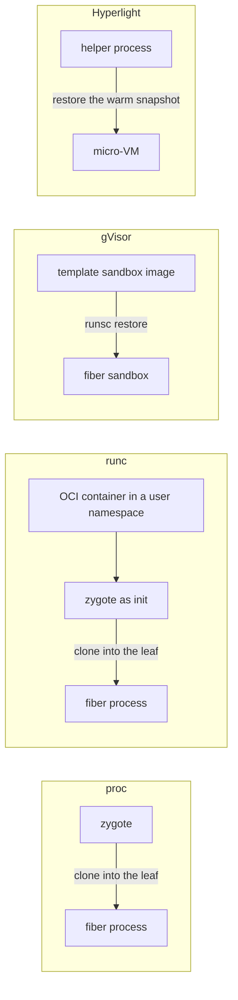

# Design: backends

This doc explains what a [backend](../glossary.md#backend) is and how the four reference backends differ. It is for anyone choosing a backend or reading `pkg/backend`. Read [architecture.md](../architecture.md) first. The [runtime host](runtime-host.md) calls a backend only for the mechanism.

## Purpose

The runtime host ([runtime-host.md](runtime-host.md)) decides when a [fiber](../glossary.md#fiber) is made, [parked](../glossary.md#park) or killed, and what it may cost. It does not know how to fork a process, restore a sandbox or snapshot a micro-VM. A backend is that mechanism alone. It knows nothing about [grants](../glossary.md#grant), [fences](../glossary.md#fence), [budgets](../glossary.md#budget) or [parity](../glossary.md#parity), so a new sandbox technology is one package, not a change to [fiberd](../glossary.md#fiberd).

## How it works

`Backend` has one method per lifecycle step. `Warm` starts one [template](../glossary.md#template) instance for a grant in a [cgroup](../glossary.md#cgroup) the host opened. `Clone` makes a fiber from it, `Park` writes a fiber into a directory, `Resume` brings one back under a new fence, and `Kill` ends one. `Exits` reports every end, asked for or not, and the host cleans up on that signal. `Name` is a parity fact, so a checkpoint from one backend is never offered to another. Everything else is an optional interface the host probes for.

| Interface | A backend implements it when |
| --- | --- |
| `Isolator` | its fibers run behind a kernel of their own. Only these serve untrusted grants |
| `EndpointSchemer` | its fibers can serve more than unix sockets under the run directory |
| `Handoffer` | its fibers read their incarnation record off a channel at birth, and a [handoff](../glossary.md#handoff) fiber keeps that channel for the connections the host passes it ([handoff.md](handoff.md)). The backend makes the pair where the fiber's checkpoint can carry it, and hands the host its end for a handoff fiber |
| `IDMapper` | its fibers run in a user namespace mapped to a range of host ids |
| `Platformer` | its checkpoints depend on something other than the host kernel and libc |
| `DeadlineAdvisor`, `Overheader`, `WMeter`, `WReporter` | a [clone](../glossary.md#clone) is slower than a fork, a fiber has a fixed footprint, or [W](../glossary.md#w-working-set) comes from another counter or from the backend itself |
| `DeviceReporter` | its [warm](../glossary.md#warm) instance is an [engine](../glossary.md#engine) that owns device state |
| `SelfCheckpointer`, `DeltaCodec` | it can checkpoint the warm instance while running and store a park as a [delta](../glossary.md#delta) over it |
| `Pooler` | it can restore a sandbox before its fiber exists and hand it an identity later |

| Backend | One fiber is | Park and resume | Isolates tenants | [Tier](../glossary.md#tier) offered |
| --- | --- | --- | --- | --- |
| proc | a forked child of the [zygote](../glossary.md#zygote) in its own cgroup leaf, pid namespace and mount namespace | `SIGUSR1`, the fiber's word that it serves nothing, then a [CRIU](../glossary.md#criu) dump stored as a delta over the zygote's own checkpoint. A resume is routed once the fiber acks its record | no, the host kernel as fiberd's uid | `FIBER_CHECKPOINT`, or `FIBER_WARM` when CRIU is missing or older than 4.2 |
| runc | a forked child of the zygote inside the grant's container | as proc, with the container's mounts named as external, restored with the grant's rootfs copy | no, the host kernel as an unprivileged host uid | the same as proc |
| gVisor | a `runsc` sandbox restored from the template image | `SIGUSR1`, the endpoint gone, then `runsc checkpoint`, a full image | yes, the Sentry serves its syscalls | `FIBER_SNAPSHOT` |
| Hyperlight | a micro-VM inside the grant's helper process, with no process or leaf of its own | the helper's snapshot | yes, the hypervisor | `FIBER_SNAPSHOT` |

A backend whose tools are missing, such as `runsc` or the Hyperlight helper, offers no tier. fiberd then refuses to start, with an error that names the backend and the reason. runc does not look for `runc`, `unshare` or `mount` when it opens, so a home without them fails at warm instead ([user-namespaces.md](user-namespaces.md#security-notes-and-known-gaps)).

**proc.** One zygote per grant, linked with libfiberzygote and driven over a control socketpair at the zygote's fd 3 ([zygote.md](zygote.md)). Every fiber gets its own pid namespace, a private mount namespace with fiberd's paths covered and other fiberd homes' mounts dropped, and no capabilities. Fibers serve unix or TCP endpoints. proc is the reference backend and the one the conformance suite runs against.

**Droppable pages.** On a kernel of 6.11 or later, a glibc of 2.41 or later answers `getrandom` from the vDSO. It keeps a per-thread key and batch of output in user pages the kernel flags droppable. The images ship criu 4.2.1, which leaves those pages out of a dump and restores their mapping droppable, so the first `getrandom` after a resume reseeds and a fork after it wipes the child's copy. An older criu dumps those pages and restores them as plain memory, so every copy resumed from one park would continue one keystream, and on recent kernels the dump fails outright. So proc and runc park only with criu 4.2 or later. With an older one they offer FIBER_WARM and log the version they found. gVisor's vDSO has no `getrandom`, so the Sentry answers each sandbox with entropy of its own.

**runc.** The proc backend with a launcher. `runc run` starts the zygote as the init of a per-grant OCI container, whose user namespace maps the grant onto host ids of its own and whose network namespace holds the loopback alone. So fiberd [relays](../glossary.md#relay) a TCP endpoint policy to the fiber's unix socket ([networking.md](networking.md)). Fibers serve unix sockets under `/host`, where the container mounts the grant's run directory, or take handed-off connections. A host client's connection is a socket from the host's network namespace, which CRIU cannot dump, so the fiber closes every connection at the park's signal before it says it serves nothing ([zygote.md](zygote.md)). A dump that still meets one is retried for up to a second and then refused by name. [user-namespaces.md](user-namespaces.md) has the id slots, the rootfs copy and the why.

When runc exits before its container is up, fiberd's error quotes the end of runc's debug log and of the zygote log.

A `-template` command names a path inside the rootfs, and the container spec for such a grant is unchanged by what follows. A registry template is staged the way gVisor stages one, with the same helper (`backend.StageTemplate`). At warm the launcher copies the executable alone into `<state>/runc/templates/<grant>/template/`, checks the copy against the hash the host verified, and adds one mount to the grant's container spec: that directory, bound read-only with `nosuid` and `nodev` at `/fiberd/template`. The command runs as `/fiberd/template/<executable>`. The copy is fiberd's, mode 0555, and the container's root is an unmapped id to it, so the mapped root reads and runs it with the other bits and cannot write, rename or chmod it. The read-only flag is a second line. runc's mounts are not locked, but the fiber filter refuses a runc fiber every mount call ([seccomp.md](seccomp.md)), so it cannot lift the flag. The container sees that one file of the host's cache. Every rootfs copy carries the empty mount point, so a copy made for a restore has it. A park names the bind an external mount beside `/host` and the device binds, records that it had one beside the images, and a resume binds the resuming home's own copy there. A park with a template bind needs the grant's warm instance on the resuming home, which is what staged the copy, and is refused by name without it. The staged copy goes with the warm instance.

**gVisor.** Every fiber is its own `runsc` sandbox restored from a checkpoint of the warm template sandbox, on the systrap platform so no KVM is needed. Every runsc command runs with `--network=none` and `--app-huge-pages=false`, so fiberd relays a TCP endpoint policy to the sandbox's unix socket. Huge pages are off because W is read from the leaf's `shmem` counter above what the leaf counted before the sandbox's hand-out, and 2 MiB pages would move a sandbox several MiB after that count. Every runsc process also starts with `PR_SET_THP_DISABLE`, so the Sentry's heap is not on 2 MiB pages either. That saves an idle sandbox about 15 MiB and costs a clone no time. Each sandbox gets a container ID no other has had, so a reaper deleting its own ID never hits a successor under the same grant or fence. The reaper waits for a sandbox on a pidfd parked in the Go poller rather than with a `runsc wait` process per fiber, and reports the sandbox's exit status when fiberd is its parent (fiberd is a container's init, where runsc reparents a detached sandbox) and `exited` otherwise. A park is a full image written with direct I/O, so its pages are never charged to the fiber's leaf. The template image lives on a tmpfs that fiberd mounts on `<state>/gvisor/templates` when the backend opens, so the warm template's memory never reaches a disk. Its mount source is `fiberd-templates`, and a proc zygote in the same mount namespace drops every mount so named before its first fiber, so no proc fiber carries the image into a checkpoint ([zygote.md](zygote.md)). It costs RAM, about one image per warm grant. The warm sandbox writes it, so it is charged to the grant's zygote cgroup and counts in the template's protected footprint and the grant's ceiling. Measured with the gVisor integration tests, a refzygote with a 64 MiB heap warms at about 147 MiB on the tmpfs and 83 MiB on disk, and its fibers cost the same either way. The image is read and written there without direct I/O, since a restore reading shmem charges its leaf nothing and kernels before 6.6 refuse direct I/O on a tmpfs. A tmpfs a previous fiberd left is kept and emptied, and fiberd unmounts the one it mounted when it closes. Before it detaches the tmpfs, the backend refuses new warms and ends and waits for those in flight, so no template image is written to the disk under the mount point. A home whose templates are large and whose memory is short keeps them on disk with `-gvisor-templates-on-disk`. That flag mounts nothing, but a tmpfs a previous fiberd left is still recognised, so images on it are written and read without direct I/O. Either way the directory and each warm's own directory are 0700, the image files 0600, and a warm's directory goes when its template sandbox exits. A backend that cannot mount the tmpfs offers no tier and says why. Restores are CPU-bound, so at most one `runsc restore` per CPU runs at once, and a birth that gets no slot before its deadline misses. A clone or resume without a deadline of its own gets one sized for the grant, and so does a park's wait for the sandbox to close its endpoint. The footprint probe at warm is timed from restore to serving, and the default is four times that, never under the floor of 500 ms for a create and 2 s for a resume, and never over 5 s.

A restored sandbox gets its incarnation record ([zygote.md](zygote.md)) on a channel, not from its spec. The spec carries a one-shot token. The template dials its warm instance's pool socket (mode 0600, read-only at `/fiberd/channel`) with the token and receives the fence, endpoint, payload, session, generation and 32 bytes of fresh entropy. The generation is the host's count of the lineage, 1 for a restore of the template image and the parked generation plus one for a resume. It reseeds, binds and acks. `Pool` restores a sandbox that waits on that read until `Bind` hands it out. A pool restore yields to any clone, so a pool never costs a clone its deadline. A resume uses the same channel, so it needs the grant's warm instance. A template that reads its spec instead, which the footprint probe detects, gets no seed and no pool, and is not supported.

A `-template` command names a path inside the rootfs. A registry template ([artifact.md](artifact.md)) lives outside it, so the backend stages it (`backend.StageTemplate`, shared with runc). At warm it copies the executable alone into `<state>/gvisor/templates/<template sandbox>/template/`, a directory that goes with the template sandbox, checks the copy against the hash the host verified, and binds that directory read-only at `/fiberd/template` in the template sandbox and in every fiber restored from it. The command runs as `/fiberd/template/<executable>`. The bind carries `ro`, `nosuid` and `nodev`, and the sandbox's init has no capabilities, so `mount(2)` inside it fails with EPERM and nothing can remount or rebind the directory. The sandbox sees that one file. It does not see the artifact's config, its images, the rest of the cache or another template. runsc checks at restore that every mount's destination, type and options match the checkpoint's, and lets the host-side source differ, so a park taken on one home resumes on another whose state and cache live elsewhere. The resuming home binds its own verified copy. A park and a home that disagree about having a template mount are refused by name. A `-template` sandbox gets no template mount.

**Hyperlight.** Hyperlight has a Rust host API only, so the mechanism lives in a helper process that fiberd starts per grant inside the grant's cgroup and drives over the line protocol in [hack/hyperlight/PROTOCOL.md](../../hack/hyperlight/PROTOCOL.md). Fibers are micro-VMs restored from the warm snapshot, named by fence, with W reported by the helper. Every CLONE and RESUME carries the generation and a 32-byte seed, which the helper hands the guest through `Incarnate` before the endpoint exists, so a sandbox reseeds before it serves and the seed is never in the helper's log. Which facts its parity covers, and why Hyperlight [homes](../glossary.md#home) keep `-parity strict`, is in [artifact.md](artifact.md).

## Security notes and known gaps

- proc and runc share the host kernel. Admission refuses an untrusted grant on either ([security.md](../security.md)).
- runc has no egress. A fiber reaches neither the network nor the host's loopback, so a workload that needs to call out cannot run there.
- A park needs the fiber's cooperation on proc, runc and gVisor. A fiber that serves on through the signal is never parked, and under pressure it is released instead, with its state lost. Nothing is dumped while a fiber serves.
- Credentials differ by backend. fiberd mints no per-fiber credential except the HANDOFF TLS identity ([handoff.md](handoff.md)). A proc fiber runs as fiberd's uid with fiberd's private paths covered, so a credential mounted elsewhere in the home is readable when its mode allows. A runc fiber sees its rootfs copy and `/host` alone. A gVisor or Hyperlight fiber sees nothing of the home but the grant's run directory, plus, on gVisor or runc with a registry template, the read-only copy of its own executable. A gVisor fiber also reaches its warm instance's pool socket, which holds at most eight unclaimed connections. A custom rootfs, bind mount or helper can expose more, so review the backend configuration rather than assume.
- A restored gVisor sandbox holds more memory than a fresh one, since its Sentry keeps the deserialized heap and runs more threads. Sandboxes share no template pages, unlike forked fibers. Sharing would mean several fibers in one sandbox, which weakens isolation, so each fiber keeps its own ([benchmarks](../benchmarks.md#head-to-head-activation)).
- The gVisor rootfs is shared by every sandbox and served by runsc's gofer, which creates a missing mount point in it. Every warm instance leaves an empty `/fiberd/channel` directory in the rootfs on the host, and a registry template an empty `/fiberd/template`. Nothing is written there afterwards, and the root is read-only inside every sandbox.
- The template cache is hidden from proc fibers ([runtime-host.md](runtime-host.md)), and proc execs a registry template through a descriptor it hashed ([artifact.md](artifact.md)). A `-template` path outside the hidden list is protected by its owner's permissions alone, and a proc fiber is the owner's uid.
- A runc template can lift the read-only flag of its template bind before `fz_serve` installs the fiber filter. Ownership is what keeps the copy unwritable.
- A gVisor template can raise its own baseline by allocating before it claims its identity, which hides that much of its W. The leaf's `memory.max` slack bounds it, and it hurts only its own grant.
