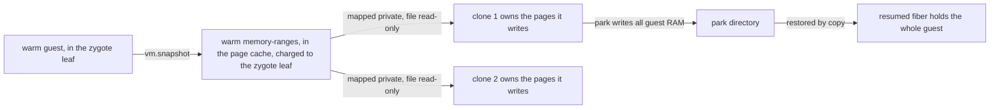

# Design: the Cloud Hypervisor backend

This doc explains how the `cloudhv` [backend](../glossary.md#backend) makes a [fiber](../glossary.md#fiber) a micro-VM, and why a [Clone](../glossary.md#clone) restores its memory copy-on-write. It is for reviewers of the backend's isolation and of its [W](../glossary.md#w-working-set) accounting. Read [backends.md](backends.md) first.

## Purpose

A `cloudhv` fiber is a Cloud Hypervisor micro-VM with a guest kernel of its own, behind KVM, so the backend isolates tenants. Each fiber is one VMM process restored from a snapshot of a [warm](../glossary.md#warm) guest.

## How it works

- **Warm.** fiberd boots one guest in the [zygote](../glossary.md#zygote)'s [cgroup](../glossary.md#cgroup), waits for the template to say READY, snapshots it and ends the VMM. The snapshot is the warm instance.
- **Clone.** fiberd starts a VMM in the fiber's leaf that restores the warm snapshot, resumes it and sends the guest its incarnation.
- **[Park](../glossary.md#park) and resume.** A park pauses the guest and snapshots it into the park directory. A resume restores that by copy.
- **The jail.** Each VMM runs in fresh mount, pid, ipc, uts and net namespaces, on a tmpfs root. It sees the VMM binary, the kernel, the rootfs, the snapshot it restores, the [grant](../glossary.md#grant)'s engine directory and a `/dev` with `null`, `urandom` and `kvm`. Its own run directory is the only writable path. It holds no capability, runs under `no_new_privs`, and runs as a per-grant uid and gid in [805306368, 822083584). fiberd refuses to open when that range meets the runc user namespace pool or the engine uid.
- **Snapshots.** fiberd moves each snapshot a VMM writes out of its reach, into a root-owned directory (0750, files 0640) in the grant's VMM group. It then checks that no VMM process still holds a descriptor or a writable shared mapping of a moved file.
- **Footprint.** Warm reports the VMM alone as each fiber's fixed footprint. The ceiling is sized from guest plus VMM, so a resume's full copy still fits.

[hack/cloudhv/PROTOCOL.md](../../hack/cloudhv/PROTOCOL.md) owns the API calls, the vsock ports and the control lines.

## Copy-on-write restore

A Clone should cost only the pages a fiber writes, so that W means the same as on proc. Four ways to restore the warm memory were weighed.

| Option | What a clone holds | Verdict |
| --- | --- | --- |
| `copy`, the VMM's default | The whole guest, so W never sees what a fiber writes | Rejected |
| `ondemand`, through userfaultfd | Every page the guest touches, reads included, in private memory | Rejected |
| file-private, a warm guest whose RAM is a file mapped shared, restored with the file mapped private | Only the pages it writes. Works before v54 too | Rejected, below |
| `copyonwrite`, new in v54 | Only the pages it writes | Chosen |

fiberd pins Cloud Hypervisor v54.0 and restores each Clone with `memory_restore_mode=copyonwrite`. The VMM maps the warm snapshot's `memory-ranges` file private over plain guest RAM, opened read-only. Its clean pages stay in the page cache, charged to the zygote leaf, which wrote the file during the snapshot and which the host protects with `memory.min`. A Resume restores by copy, since a park directory is not fiberd's to keep unchanged.

`copyonwrite` is also the more secure choice.

- **No VMM holds shared memory writable.** The file is root-owned 0640, shown through a read-only bind and opened read-only. A clone's writes land in its own pages, so a compromised VMM cannot change what other clones see.
- **file-private would hand the tenant a writable shared base.** The warm VMM runs the tenant's guest and would map every clone's base memory shared and writable. A write after the snapshot would show in every clone, and a truncate would crash them. Closing that takes new fiberd code to end the VMM, seal the file and check that nothing still holds it writable, and each step is a place for a bug.
- **The file never changes under a clone.** A re-warm renames a fresh file in, and Unwarm and the startup cleanup unlink it. A live clone keeps the inode it mapped.
- **Sharing stays inside a grant.** Clones of one grant share clean pages, which is the point. Each grant has its own warm snapshot that only its VMMs see, so no page is shared across grants.
- **Every restore reseeds the guest kernel.** v54 gives the guest a fresh vmgenid on each restore. The template still reseeds its own generators from the incarnation's seed, as on every backend.

## Security notes and known gaps

- `copyonwrite` is new upstream code, merged in August 2026.
- When v54 cannot restore copy-on-write, it falls back to copy without saying so. fiberd writes a line to the grant's log when a VMM maps no `memory-ranges`, and nothing more.
- A park of a copy-on-write clone writes all guest RAM, and its resume shares no pages with the warm snapshot.
- W counts the distinct guest pages written since the restore, as the guest's page allocator spreads them. It never shrinks, since the guest has no balloon.
- A guest kernel panic reboots the guest instead of ending the VMM. fiberd does not detect it yet, and the fiber comes back as a fresh guest.
- Two grants can hash to one VMM uid, and fiberd does not refuse it. Their VMMs are then kept apart by their namespaces alone.
- `vm.snapshot` fails on hosts with `kvm_intel` `nested=0` and a host kernel of 7.2.9 or later, or 6.18.56 or later ([cloud-hypervisor#9086](https://github.com/cloud-hypervisor/cloud-hypervisor/issues/9086)). The fix landed upstream after v54.0.
- No workspaces and no handoff grants. A passed TCP socket cannot cross into a VM.
