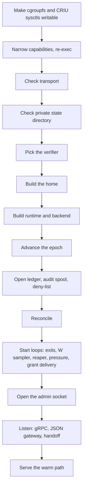

# Design: fiberd process

[fiberd](../glossary.md#fiberd) is one process per [home](../glossary.md#home). This doc covers how it starts and stops and where it keeps its state. It is for readers changing startup or adding a new home. Read [architecture.md](../architecture.md) first.

## Purpose

fiberd wires the verifier, the home, the runtime, the ledger, the audit spool and the servers together. If it served before its view of the home were real, it could mint [fences](../glossary.md#fence) that collide with old ones. If it started half-configured, it could serve without caller identity or write its keys where [fibers](../glossary.md#fiber) can read them. So the start order is fixed, and every misconfiguration fails the start instead of degrading.

## How it works



fiberd is a library whose entry point is `RunContext`. A binary or a test owns fiberd's lifetime through its context. fiberd also stops on SIGINT or SIGTERM. `cmd/fiberd` is this library plus the core homes, and `-home standalone|kubernetes` picks one. `standalone` is the default.

These checks fail the start.

- **Mounts.** Before anything else, the binary makes a read-only cgroup mount and the [CRIU](../glossary.md#criu) sysctls writable, for every runtime but the stub ([sys.md](sys.md)). This comes before narrowing, because the remount needs a capability the narrowed set may lack. A cgroup mount it cannot make writable fails the start. Sysctls that stay read-only are only a warning, and fibers then get only the warm [tier](../glossary.md#tier).
- **Capabilities.** Next, fiberd re-executes with only the capabilities its runtime needs ([sys.md](sys.md)). Cloud Hypervisor and the stub are not measured, so with them fiberd keeps everything. If it cannot drop the rest, it exits, unless `-all-caps` is set.
- **Transport.** TLS is checked before anything is built, so a bad setup leaves nothing half-started ([grant.md](grant.md)).
- **Private directory.** It is created with mode 0700, and an existing one is reset to 0700. A symlink or a non-directory at that path is refused. A proc fiber runs as fiberd's uid and sees the state directory outside `private/` and `deltas/`, so a symlink it planted there would send the keys wherever it points.
- **Verifier.** One must be named, and the JWKS verifier needs an [issuer](../glossary.md#issuer).
- **Endpoints.** With an inet4 or inet6 family and no `-endpoint-host`, fiberd asks the home for the fibers' address, such as the Pod IP. A home that answers with no address of that family fails the start.
- **Deny-list.** An unreadable deny-list fails, as [core.md](core.md) explains.
- **Listeners.** The gRPC, `-http` and [handoff](../glossary.md#handoff) addresses are bound before serving, so an address that cannot be bound fails the start.

The state layout keeps what fibers must never read under one hidden directory.

```text
<state>/                default /var/lib/fiberd
  private/              mode 0700, hidden from every fiber
    epoch               fiberd's start counter
    ledger.json         snapshot of grants and parked sessions
    revoked.json        the deny-list
    audit.jsonl         the audit spool
    admin.sock          the admin socket
    *-key.json          generated audit, delta, seal and handoff keys
  templates/            the pulled template cache, hidden from fibers
    parents/            parent checkpoints, mode 0700
    zygote-images/      self-checkpoints not yet filed, mode 0700
    <digest>/images/    author images opened for a warm, mode 0700, pruned
                        once no warm instance or delta names them
  deltas/               parked deltas, also hidden from fibers, swept at
                        start of those no parked session names
  workspaces/           running fibers' workspaces (-workspace-dir), mode
                        0700 (0711 on runc, whose mapped root walks to its
                        own), hidden from fibers, each mounted at /workspace
                        in its own fiber alone, swept at start
  run/                  fiber endpoints (unix sockets) and zygote logs, one
                        directory per grant, which fibers see
  runc/, gvisor/        backend state, with each grant's staged template copy
                        and, on gVisor, each warm instance's pool socket
  gvisor/templates/     gVisor's template images, mode 0700, on a tmpfs
                        unless -gvisor-templates-on-disk
```

The private directory is hidden rather than protected by file modes, and so are the [template](../glossary.md#template) cache and the deltas. A proc fiber warmed from a registry template still sees its own executable, bound back read-only inside the cache's cover, because [CRIU](../glossary.md#criu) needs the path to resolve. The full list of what fibers cannot see is in [runtime-host.md](runtime-host.md).

**Stop.** SIGTERM stops fiberd at once unless `-drain-timeout` sets a budget. With one, fiberd first [drains](../glossary.md#drain) for up to that long. From the drain's first moment every Clone is a deferred miss, attach included, and `GET /readyz` on the admin socket answers 503 with `"draining": true`. `/readyz` is also 503 whenever `/healthz` is, so a readiness probe belongs on `/readyz` and a liveness probe on `/healthz`. `fiberd readyz` and `fiberd healthz` ask a running fiberd for each and exit non-zero on anything but a 200. fiberd parks the named sessions first, with sync, and publishes their deltas as any park does. Then it releases the anonymous fibers. A fiber the drain does not reach in time ends with the runtime. The ledger snapshot is saved either way, so the parked sessions resume after a restart.

A second SIGTERM or a SIGINT ends the drain early. A binary that embeds fiberd should leave SIGTERM to it, because cancelling the context ends the drain at once. A home that should keep its sessions across a stop sets `-drain-timeout` below the platform's grace period, with room for the stop that follows. That is the Pod's `terminationGracePeriodSeconds` on Kubernetes and `KillWait` on Slurm, both 30 seconds by default.

## Security notes and known gaps

- **Generated keys are per home.** A key that no flag names is generated with a warning. No other home trusts it, so homes that move [sessions](../glossary.md#session) between them must share keys.
- **`-insecure-plaintext`** logs a warning at start. What it gives up is in [grant.md](grant.md).
