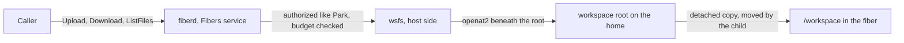
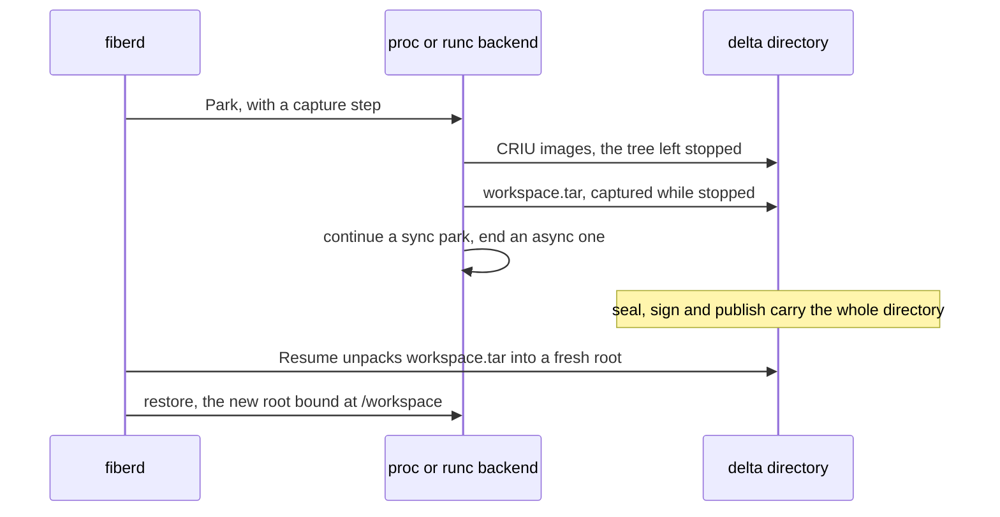

# Design: file transfer

This doc explains how a caller moves files into and out of a running [fiber](../glossary.md#fiber), and how those files survive a [park](../glossary.md#park). It is for reviewers of the feature as a whole. The RPCs and their error codes are in [protocol.md](../protocol.md#files). The file layer that runs as root in a tree the fiber controls is in [wsfs.md](wsfs.md).

## Purpose

A [session](../glossary.md#session) often needs a dataset in and a result out. A [grant](../glossary.md#grant) that sets a disk budget gives each of its fibers a private workspace, which the fiber sees at `/workspace`. [fiberd](../glossary.md#fiberd) reads and writes it from the host side, never through the fiber. A park carries the workspace inside the [delta](../glossary.md#delta), so a resumed fiber finds its files where it left them.

## How it works

**The calls.** `Upload`, `Download` and `ListFiles` sit on the `Fibers` service beside Clone and Park. They are keyed by fiber ID and authorized like Park, so another caller's fiber answers `NotFound`. The admission interceptor checks every message of a stream for unknown fields, as it does for unary calls. An upload declares its size in its first message, so a file over the budget is refused before a byte lands.

**The budget.** `disk_budget_bytes` is a grant field ([protocol.md](../protocol.md#grant-fields)). Zero means no workspace, and every file call on such a fiber answers `FailedPrecondition` with a `NoWorkspace` detail. A [home](../glossary.md#home) whose [backend](../glossary.md#backend) gives fibers no workspace refuses a grant that sets it at admission. proc and runc give one.

**The workspace.** The host runtime makes an empty workspace before the backend makes the fiber, and removes it when the fiber ends ([runtime-host.md](runtime-host.md)). The directory holding every workspace is hidden from fibers. fiberd passes the fiber's root as a detached mount on the [zygote](../glossary.md#zygote)'s CLONE line with the `ws` option. The child moves it onto `/workspace` before any [template](../glossary.md#template) code runs ([zygote.md](zygote.md)). On runc the child first gets its own copy of the container's mount namespace, and the move passes the fiber filter through one gated instruction ([seccomp.md](seccomp.md#why-clone3-is-gated)).

**Park and resume.** [CRIU](../glossary.md#criu) records open files by path, not content, so the bytes travel apart from the images. The dump leaves the fiber stopped, and fiberd captures the tree as `workspace.tar` beside the images. The archive then holds exactly what the images saw. The workspace bind is always named external to CRIU, so its bytes never land in the memory images. A resume unpacks the archive into a fresh workspace before the restore. A delta and a grant that disagree on having a workspace are refused. The delta quota counts the workspace's apparent size before the dump.

**Clients.** The Go, Python and TypeScript clients upload, download and list files. They raise `QuotaExceeded` for a file over the budget and `NoWorkspace` for a zero budget, apart from a tier gap ([sdk.md](sdk.md)).

**Choices a reviewer will ask about.**

| Choice | Why |
| --- | --- |
| RPCs on `Fibers`, not a side channel through the fiber's endpoint | A `DIRECT` endpoint is a route, not an identity, so it would carry files with no caller check and need a cooperating template |
| The workspace rides the delta as `workspace.tar` | It reuses the seal, signature, quota and mobility paths, and cannot drift from the memory it belongs to |
| A zero budget means no workspace | It fails closed, so a grant that never asked for disk gets none |
| A fixed `/workspace` path | Clone shapes no workload, so the path is not the caller's to pick |

## Security notes and known gaps

- fiberd runs as root in a tree the fiber controls. [wsfs.md](wsfs.md) owns the rules that keep a planted link, FIFO or hard link from turning that against the host.
- **Budget not kernel-enforced.** The budget counts only what fiberd writes, in memory. A fiber's own writes are checked only at park, where a tree over the budget by apparent size, or over 65 536 entries, fails the capture and the fiber runs on. Between parks a fiber can fill the disk that holds the workspaces. The fiber filter already refuses the project-quota ioctls on proc, so a later project quota cannot be escaped ([seccomp.md](seccomp.md#security-notes-and-known-gaps)).
- **gVisor and Hyperlight.** They give fibers no workspace, so they refuse a grant with a disk budget. Hyperlight's guest has no file system.
- **Between homes.** Publish, claim, export and import carry the delta directory whole, `workspace.tar` with it. No test yet moves a workspace from one home to another.
- **Not audited or throttled.** A file call writes no audit record. There is no cap on concurrent transfers and no idle timeout per stream.
- **Plaintext on the home.** Workspace bytes and the local `workspace.tar` (0600) are in the clear on the home, like the images beside them. They are sealed only when the delta leaves ([artifact.md](artifact.md#security-notes-and-known-gaps)).
- **Every park copies the whole tree.** A large workspace lengthens every park, including pressure parks meant to free memory fast.
- runc adds limits on parking a fiber with a workspace, listed in [backends.md](backends.md#security-notes-and-known-gaps).
