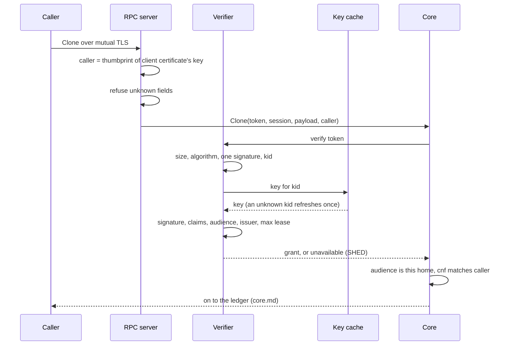

# Design: grant verification

[Grant](../glossary.md#grant) verification decides, offline, whether a [Clone](../glossary.md#clone) may spend a grant's capacity and who may act on its [fibers](../glossary.md#fiber). It is for readers changing the verifier, the transport or caller checks. Read [security.md](../security.md) first. The token's wire layout belongs to [protocol.md](../protocol.md).

## Purpose

A caller hands [fiberd](../glossary.md#fiberd) a signed grant with every Clone. The [home](../glossary.md#home) must check it with no round trip to the [issuer](../glossary.md#issuer). It must refuse a forged token, one for another home, a lease longer than policy allows, and a copied token replayed by another caller. It must also stop one caller from [parking](../glossary.md#park), [releasing](../glossary.md#release) or watching another caller's fibers.

## How it works

**Token checks.** Each of these must pass before the grant is trusted.

- A token over 8 KiB is refused before parsing. The same bound holds for the unverified peeks at the UID and the lease end, and the grant directory never reads a larger file.
- Only EdDSA and ES256 are accepted, before any key lookup, so `none` and symmetric algorithms never reach verification. The token has exactly one signature and a `kid`, and its algorithm must match the key's.
- The registered claims (`iss`, `aud`, `jti`, `exp`) must agree with the grant claim inside the token.
- The UID must be a DNS-1123 label, and the tenant, when set, one path segment ([grant fields](../protocol.md#grant-fields)).
- The audience must be this home and the issuer the configured one.
- With `-max-lease`, a grant signed for longer (`exp` minus `iat`), or with no lease, is refused.

The verifier does not enforce `exp`. Lease expiry is a capacity miss the [core](core.md) handles.

**Keys.** Keys come only from OIDC discovery of the configured issuer, and the discovery document must name that same issuer. Neither the discovery fetch nor the key fetch follows a redirect, and an https issuer must name an https `jwks_uri`. Keys are looked up by `kid` alone. An unknown `kid` triggers one refresh, at most once a minute. A key set older than `-jwks-max-stale` is refreshed once, and is refused if still stale. A stale key set, or one never loaded, makes the token unverifiable rather than bad, so the answer is [SHED](../glossary.md#clone-misses), not `Unauthenticated`. Each refresh is the standalone home's liveness signal ([home.md](home.md)).

**Caller binding.** The `cnf` claim ([RFC 7800](https://www.rfc-editor.org/rfc/rfc7800)) binds a grant to one caller. Its `jkt` member is the [RFC 7638](https://www.rfc-editor.org/rfc/rfc7638) thumbprint of the public key in the caller's client certificate. That is the base64url SHA-256 of the key's canonical JWK, 43 characters. A `cnf` that is null or has no `jkt` is refused. So is a `cnf` that carries `x5t#S256`, the hash of a whole certificate, alone or beside a `jkt`. A bound grant presented over another key, or over plaintext, is refused. A home serving mutual TLS refuses unbound grants.

The thumbprint exists for RSA, P-256, P-384, P-521 and Ed25519 keys. A client certificate over another key, P-224 for example, cannot name a caller. `grant-issuer mint -bind-cert` fails on it. A mutual-TLS call that presents one is refused as `Unauthenticated` on gRPC and with 401 on the JSON gateway, `/healthz` included.

A caller that renews its certificate over the same key keeps the same thumbprint, so its grants keep working with no new mint. A caller with a new key is refused as `Unauthenticated` until its grants are minted for the new key, under the same UIDs or new ones. Clone runs under the grant the home has admitted, not under the token's own claims. The verifier does not enforce `exp` either. So an older token for a UID, bound to the same key, keeps working while the home keeps that UID admitted and renewed. A home that does not hold the UID answers a token whose [lease](../glossary.md#lease) has run out with a capacity [miss](../glossary.md#clone-misses). A home that holds its [own grant](../glossary.md#own-grant) admits that grant on its UID, never the presented token ([home.md](home.md#own-grant)). When a token names another caller than the already admitted grant with that UID, it is refused until the home delivers the grant again.

**Transport and ownership.** The gRPC API and the JSON gateway require TLS 1.3 and a client certificate signed by `-client-ca`. The start fails unless exactly one of these holds.

- All three TLS files are set, `-tls-cert`, `-tls-key` and `-client-ca`.
- `-insecure-plaintext` is set, and no TLS file is.

fiberd re-reads the three files when their mtime or size changes, checked at most once per second. A renewal that fails to load keeps the previous certificate and client CA. It is logged once and retried when the files change again. A bad file at start still fails the start.

The thumbprint of the certificate's key is the caller on every call. Park, Release and the [file calls](../protocol.md#files) answer `NotFound` for a fiber whose grant is bound to another caller, the same as for a fiber that does not exist. Watch and the gateway's status report only the caller's grants.

**Admission completeness.** The RPC server refuses unknown fields at any depth before the core sees a Clone, so a caller cannot shape the workload the [template](../glossary.md#template) fixed ([protocol.md](../protocol.md#admission-completeness)).

**Issuer.** The reference issuer, which `grant-issuer` and the Kubernetes controller use, checks each grant before it signs it and names every fault at once. Beyond the [grant field](../protocol.md#grant-fields) rules, each fiber count must fit in 32 bits, and four times `fibers.max` times `w_budget_bytes` must fit in 64. A set lease expiry must be whole seconds. A set template digest must be one key without whitespace or `=`. The issuer can sign from a key ring. Its newest key signs, and retired keys stay in the published key set, so the grants they signed still verify. Renewal signs a token this issuer signed again, with the same claims and a fresh lease of the same length. A token whose lease has run out can be renewed too.

**Development modes.** The `insecure-json` verifier checks no signature and must be chosen explicitly. `-insecure-plaintext` is a separate switch. It serves without TLS and without caller identity, so every caller sees every grant. `fiberd run` is the exception. Its default, `-trust insecure`, turns both on, on loopback, to try a template on one machine.

## Security notes and known gaps

- **A caller's key rotation means re-minting.** The thumbprint covers the certificate's key, so a renewal over the same key needs nothing. A caller with a new key needs its grants minted again for it, under the same UIDs or new ones. On Kubernetes with cert-manager, a renewal keeps the key only when the caller's Certificate sets `privateKey.rotationPolicy: Never`. With key rotation on, every renewal is a new key and the grant must be minted again. Keep leases short.
- **An unbound JWT is a bearer token.** Anyone holding it can spend the capacity at the named home. Keep tokens out of logs, annotations and readable files. Over plaintext only unbound grants work.
- **Without `-max-lease`** a grant may carry no lease and never expire.
- **A key ring holds private keys.** One stored key prints only its kid, algorithm and retirement time. A whole ring handed to a logger is encoded with every private key, so log only its kids.
