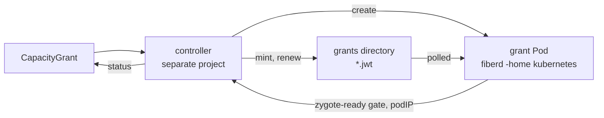
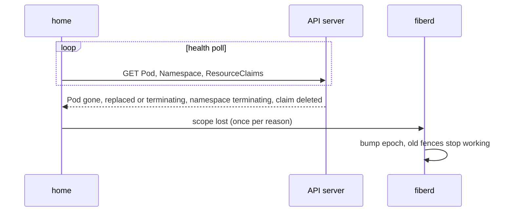

# Kubernetes integration

This is the design of [fiberd](../glossary.md#fiberd)'s Kubernetes [home](../glossary.md#home) in `pkg/home/kubernetes` and the grant Pod it runs in. It is for readers who run fiberd on a cluster or change the home. Read [architecture](../architecture.md) and [the home interface](home.md) first. Operator steps live in [operating on Kubernetes](../operating-kubernetes.md).

The home is part of fiberd's core, and there is one fiberd binary. A grant Pod runs fiberd's own image with `fiberd -home kubernetes`. The production controller is a separate project, [fiberd-k8s-controller](https://github.com/Azure/fiberd-k8s-controller), which pins a fiberd release. It creates grant Pods, lists the readiness gate on them and mints their grants.

## Purpose

A cluster schedules Pods, not [fibers](../glossary.md#fiber). fiberd needs a place to run, a signed [grant](../glossary.md#grant) addressed to that place, and a signal when the place loses its authority. The home maps each need onto plain Kubernetes objects, and the controller creates those objects.

## How it works

**Controller.** The controller is the [issuer](../glossary.md#issuer). It mints and renews with the reference issuer, which checks each grant before it signs and keeps a ring of keys ([grant.md](grant.md)).

**Grant Pod.** The Pod's container runs `fiberd -home kubernetes`. The downward API fills `POD_NAME`, `POD_NAMESPACE` and `POD_UID`, the defaults of `-pod-name`, `-pod-namespace` and `-pod-uid`. Without `-node-id` the Pod's name is its node id, so the node id and the grant's audience match. A proc Pod needs only the capabilities proc needs ([capabilities](sys.md)). It needs an Unconfined seccomp profile, because [CRIU](../glossary.md#criu) cannot dump from under a filter. `fiberd healthz` and `fiberd readyz` are the probe commands ([fiberd.md](fiberd.md)).

**[Home](../glossary.md#home).** The home answers fiberd's questions from the Pod itself.

| fiberd asks | The Kubernetes home answers |
| --- | --- |
| How grants arrive | `*.jwt` files in `-grants-dir`, the directory the control plane delivers grants into, polled. The home fetching its own grant from the control plane with the Pod's token comes with a later change |
| Control-plane liveness | The API server answering for the Pod, its namespace and its ResourceClaims, asked every half stale time-to-live (TTL) |
| Readiness | The Pod condition `fiberd.io/zygote-ready`. Its reason is `TemplateWarm` while any grant's [template](../glossary.md#template) is [warm](../glossary.md#warm), and `NoWarmTemplate` otherwise |
| The [cgroup](../glossary.md#cgroup) subtree | `-cgroup-root`, else the container's own. The kubelet's memory limit is the ceiling, and its memory QoS is what lets the template's `memory.min` hold above the delegated root ([resources.md](resources.md)) |
| Endpoints | The Pod IP of the configured family, waited for up to 90 seconds |
| [Device channel](../glossary.md#device-channel) | The Pod's Dynamic Resource Allocation (DRA) claim, or a static device list |
| [Scope](../glossary.md#scope) | `namespace`, `pod`, `pod_uid`, `service_account`, `node`, and one `resource_claim` per ResourceClaim |

An unprivileged Pod gets cgroupfs and the CRIU sysctls read-only. fiberd makes them writable at start, before it narrows its capabilities ([fiberd.md](fiberd.md)).

A cluster that serves no ResourceClaims is a loss too, once the Pod's claims have been unreadable for the stale TTL.

## Security notes and known gaps

The notes on namespaces and AppArmor apply to the home. The others describe the retiring example in `examples/kubernetes`, which projected each grant into its Pod as a Secret and stays only until the controller project replaces it.

- `status.ready` is not the Pod's Ready condition ([routing on both](../operating-kubernetes.md#readiness-and-status)).
- `status.endpoint` uses the primary `podIP`, while the home picks by family. On dual stack they can differ.
- The [epoch](../glossary.md#epoch), the ledger snapshot and the audit spool live on `emptyDir`. A container restart keeps them and a Pod replacement does not, so a replacement Pod can restart at epoch 1 and repeat old [fences](../glossary.md#fence).
- There is no finalizer and no rollout. Deleting a CapacityGrant garbage-collects its Pod at once, and a changed `spec.pod` never reaches a running Pod.
- A terminating namespace is scope loss. If the home sees it while fiberd [drains](../glossary.md#drain), the epoch bump ends every fiber not yet parked.
- Discovery and the JWKS are served over plain HTTP inside the cluster.
- runc, gVisor and Hyperlight Pods run privileged, although the capability set each needs is measured.
- On a node whose containerd applies its default AppArmor profile, fiberd's cgroupfs and sysctl remounts are denied, so an unprivileged Pod needs `appArmorProfile: Unconfined`, which the example does not set.
- The example's grants are not bound to a certificate. The JWT in the Secret is a bearer token until its lease ends.
