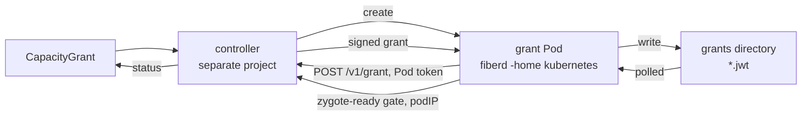
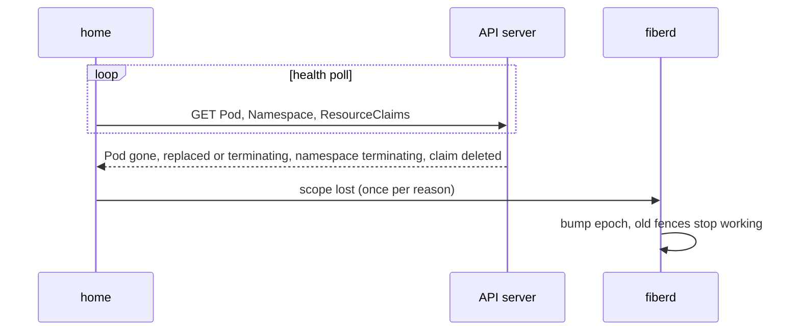

# Kubernetes integration

This is the design of [fiberd](../glossary.md#fiberd)'s Kubernetes [home](../glossary.md#home) in `pkg/home/kubernetes` and the grant Pod it runs in. It is for readers who run fiberd on a cluster or change the home. Read [architecture](../architecture.md) and [the home interface](home.md) first. Operator steps live in [operating on Kubernetes](../operating-kubernetes.md).

The home is part of fiberd's core, and there is one fiberd binary. A grant Pod runs fiberd's own image with `fiberd -home kubernetes`. The production controller is a separate project, [fiberd-k8s-controller](https://github.com/Azure/fiberd-k8s-controller), which pins a fiberd release. It creates grant Pods, lists the readiness gate on them and mints their grants.

## Purpose

A cluster schedules Pods, not [fibers](../glossary.md#fiber). fiberd needs a place to run, a signed [grant](../glossary.md#grant) addressed to that place, and a signal when the place loses its authority. The home maps each need onto plain Kubernetes objects, and the controller creates those objects.

## How it works

**Controller.** The controller is the [issuer](../glossary.md#issuer). It mints and renews with the reference issuer, which checks each grant before it signs and keeps a ring of keys ([grant.md](grant.md)). Each grant Pod asks the controller's grant endpoint for its own grant ([grant fetch](#grant-fetch)).

**Grant Pod.** The Pod's container runs `fiberd -home kubernetes`. The downward API fills `POD_NAME`, `POD_NAMESPACE` and `POD_UID`, the defaults of `-pod-name`, `-pod-namespace` and `-pod-uid`. Without `-node-id` the Pod's name is its node id, so the node id and the grant's audience match. A proc Pod needs only the capabilities proc needs ([capabilities](sys.md)). It needs an Unconfined seccomp profile, because [CRIU](../glossary.md#criu) cannot dump from under a filter. `fiberd healthz` and `fiberd readyz` are the probe commands ([fiberd.md](fiberd.md)).

**[Home](../glossary.md#home).** The home answers fiberd's questions from the Pod itself.

| fiberd asks | The Kubernetes home answers |
| --- | --- |
| How grants arrive | With `-grant-token-file` set, the home fetches its own grant from the controller's grant endpoint with the Pod's token, writes it into `-grants-dir` and renews it at half the remaining lease. The directory is polled, so other `*.jwt` files dropped into it are read too, and without the flag they are the only way |
| Control-plane liveness | The API server answering for the Pod, its namespace and its ResourceClaims, asked every half stale time-to-live (TTL) |
| Readiness | The Pod condition `fiberd.io/zygote-ready`. Its reason is `TemplateWarm` while any grant's [template](../glossary.md#template) is [warm](../glossary.md#warm), and `NoWarmTemplate` otherwise |
| The [cgroup](../glossary.md#cgroup) subtree | `-cgroup-root`, else the container's own. The kubelet's memory limit is the ceiling, and its memory QoS is what lets the template's `memory.min` hold above the delegated root ([resources.md](resources.md)) |
| Endpoints | The Pod IP of the configured family, waited for up to 90 seconds |
| [Device channel](../glossary.md#device-channel) | The Pod's Dynamic Resource Allocation (DRA) claim, or a static device list |
| [Scope](../glossary.md#scope) | `namespace`, `pod`, `pod_uid`, `service_account`, `node`, and one `resource_claim` per ResourceClaim |

An unprivileged Pod gets cgroupfs and the CRIU sysctls read-only. fiberd makes them writable at start, before it narrows its capabilities ([fiberd.md](fiberd.md)).

A cluster that serves no ResourceClaims is a loss too, once the Pod's claims have been unreadable for the stale TTL.

### Grant fetch

**Request.** `-grant-token-file` names the Pod's bound service-account token and turns the fetch on. It then needs `-issuer` and `-grants-dir`. With the flag empty there is no fetch, and grants arrive only as `*.jwt` files. The grant endpoint is `-issuer` followed by `/v1/grant`. It must be https, because every request carries the Pod's token, and its certificate must chain to the PEM bundle in `-grant-ca-file`, or to the system roots when that flag is empty. `-grant-ca-file` without `-grant-token-file` is refused. Each request is a POST with the token as a bearer, read from the file every time, so it follows the kubelet's rotation. The body is an empty object on the first issuance. On a renewal or a restart it carries `previous`, the current grant. The answer is the signed grant with its UID, audience and lease times.

**Write and start.** The home checks that the grant's UID is the Pod's UID. It writes the grant atomically to `<grants-dir>/<uid>.jwt`, never removes or truncates that file, and the directory's poll picks it up like any other ([home.md](home.md)). [Clone](../glossary.md#clone) admits only that UID on first sight. A token minted for an earlier Pod of the same name is refused as unauthenticated, so it cannot re-mint that Pod's [fences](../glossary.md#fence) here. fiberd retries the first fetch for up to `-grant-fetch-timeout`, 60 seconds by default, and then refuses to start. A container that restarts with an unexpired grant file starts on that file once the timeout passes, and keeps retrying. A 409 ends the first fetch's retries at once, and so does a SIGTERM, as a clean stop.

**Renewal.** The home renews at half the remaining lease. A failed request backs off from 1 second, doubling each time, capped at 30 seconds or a quarter of the remaining lease, whichever is less, with jitter. A 429 or a 503 with `Retry-After` waits what the header says, up to a quarter of the remaining lease. A 401 or 403 means the token was refused, and the home re-reads it and retries every 30 seconds. A 409 means the Pod is terminating or the grant is being deleted, and renewal stops. A 422 means the grant cannot be issued as specified, retried every 5 minutes. A controller outage leaves the current grant serving until its lease ends, which gives renewal half a lease of retries. With `-jwks-max-stale` set to the lease, as its help asks, the verifier's key set goes stale at about the same time ([grant.md](grant.md)). No token, the Pod's or a grant's, reaches a log line.

## Security notes and known gaps

- The [epoch](../glossary.md#epoch), the ledger snapshot and the audit spool live on `emptyDir`. A container restart keeps them and a Pod replacement does not, so a replacement Pod restarts at epoch 1 and can repeat old [fences](../glossary.md#fence).
- A terminating namespace is scope loss. If the home sees it while fiberd [drains](../glossary.md#drain), the epoch bump ends every fiber not yet parked.
- On a node whose containerd applies its default AppArmor profile, fiberd's cgroupfs and sysctl remounts are denied. An unprivileged Pod needs `appArmorProfile: Unconfined` beside its Unconfined seccomp profile.
- proc fibers run as fiberd's uid, so file modes cannot keep the Pod's token from them. fiberd hides the directory of `-grant-token-file` from fibers instead.
- A privileged Pod hands fiberd's container far more than the measured set its backend needs ([sys.md](sys.md)). Which runtimes run privileged is the controller's choice.
- Without `-client-ca`, no grant is bound to a caller certificate, and its JWT is a bearer token until its lease ends ([security.md](../security.md#grants)).
