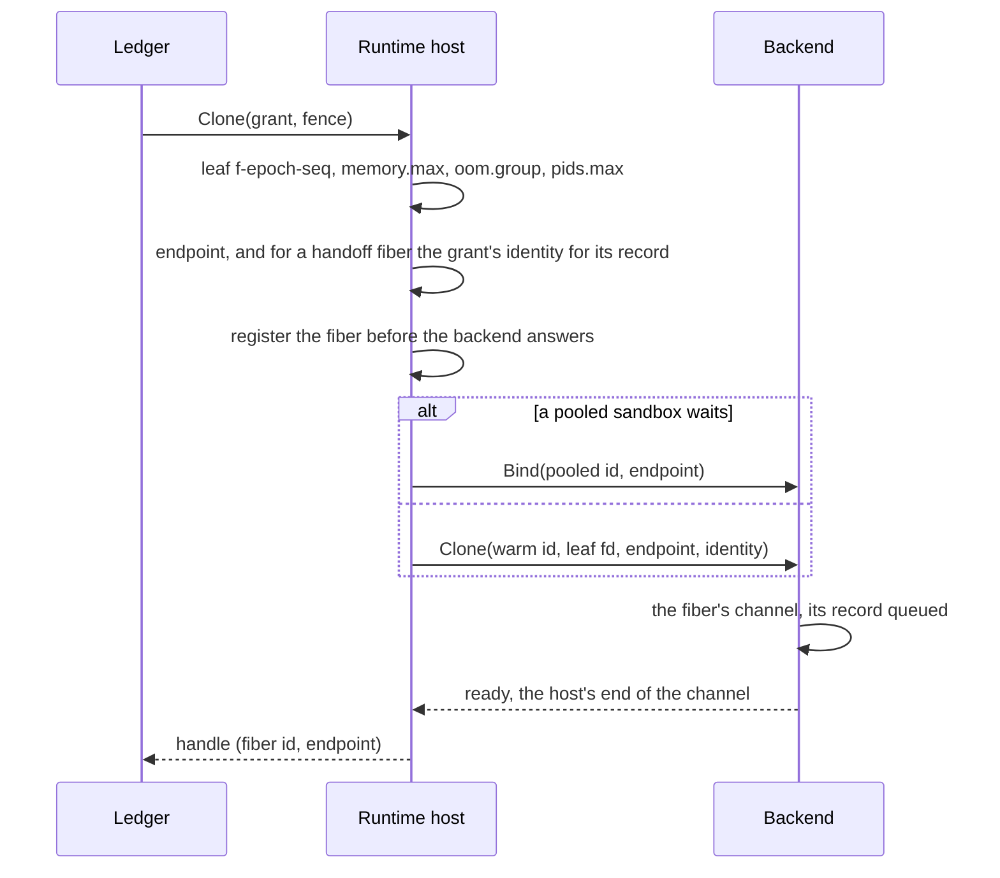
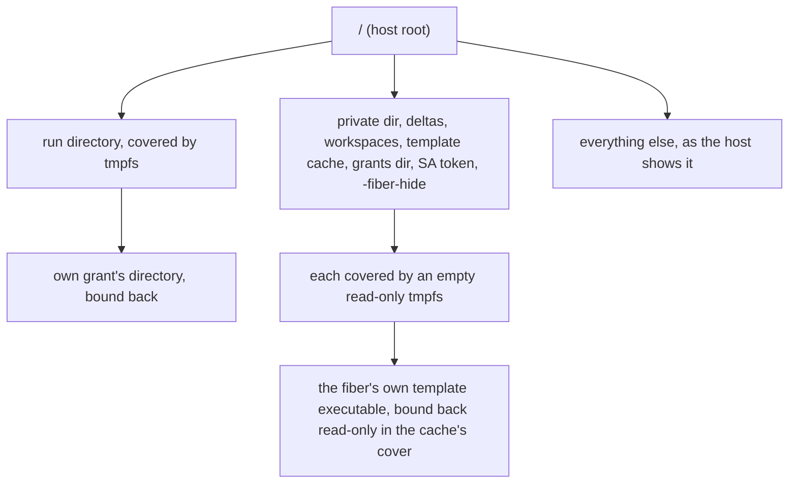

# Design: runtime host

This doc explains the runtime host, the layer between [fiberd](../glossary.md#fiberd)'s ledger and a sandbox [backend](../glossary.md#backend). It is for contributors and backend authors. Read [architecture.md](../architecture.md) first, and [backends.md](backends.md) after this doc.

## Purpose

A backend knows how to fork, checkpoint and restore, and nothing else. Every backend still needs the same surroundings. Each [fiber](../glossary.md#fiber) needs a memory limit, an endpoint and a view of the filesystem that hides fiberd's secrets, and each [park](../glossary.md#park) needs a size bound. The runtime host does that work once, the same way for every backend.

## How it works

- **[Warm](../glossary.md#warm).** At admission the host resolves the [template](../glossary.md#template) (see [artifact.md](artifact.md)), makes the [grant](../glossary.md#grant)'s [cgroup](../glossary.md#cgroup), and asks the backend to start the warm instance in a `zygote` child cgroup. On proc and runc that instance is a [zygote](../glossary.md#zygote). It registers a parent checkpoint for [deltas](../glossary.md#delta), protects the template's pages with `memory.min`, and sets the grant's ceiling. A warm instance that dies is warmed again on the next [Clone](../glossary.md#clone).
- **The leaf.** The host makes a leaf for each fiber, `f-<epoch>-<seq>`, capped at its [W](../glossary.md#w-working-set) [budget](../glossary.md#budget) plus any fixed footprint. proc, runc and gVisor fibers run in it. A Hyperlight fiber is a micro-VM inside the grant's helper, which runs in the grant's cgroup, so its leaf stays empty and the budget is enforced by sampling W. A backend that maps the grant to a user namespace (runc) is given the leaf's `cgroup.procs` and nothing else, so every limit stays the host's. The limits are in [resources.md](resources.md), and the endpoint forms in [networking.md](networking.md).
- **Pool.** On gVisor, `Fill` restores a sandbox ahead of its fiber in a leaf `pool/p-<n>`. A Clone binds the oldest one, and restores on demand when none waits or the hand-out fails. The fiber keeps the leaf, since cgroup v2 cannot rename one. A pooled sandbox is not a fiber until then. The pool drains when the template goes, and a restart removes every `pool/` leaf.
- **W.** On proc and runc, W is the leaf's `memory.current`, and the kernel enforces the budget. gVisor counts W as the leaf's `shmem` less what the leaf held just before the sandbox took its identity, since restores of one image settle MiB apart. A resumed fiber carries on from the W it was parked with. The Hyperlight helper reports W itself. For those backends the leaf gets extra room, and the host samples W every 25 ms and kills a fiber over its budget.
- **Hidden paths.** Fibers must not see the Kubernetes service-account token, fiberd's private directory (keys, ledger, [epoch](../glossary.md#epoch), audit spool), the delta directory, the workspace directory, the template cache (pulled templates, their configs and images, the parent checkpoints and the zygote self-checkpoints), `-grants-dir` and every `-fiber-hide` path. proc fibers run as fiberd's uid, so file modes cannot keep them out. A backend that gives fibers their own mount namespace covers each path with an empty read-only tmpfs. A relative path, or one that holds the run directory, is skipped with a log line. A private, delta or template cache directory that holds the run directory fails the start.
- **The fiber's own executable.** A proc zygote warmed from a registry template runs from the cache, and CRIU names a mapped file by its path, which must resolve in the fiber's namespace to the file it maps. So when a hidden directory holds the zygote's own executable, the zygote covers the directory and binds the executable back at its own path, read-only, from a descriptor it opened before the cover ([zygote.md](zygote.md)). A fiber sees the cache as an empty tree with that one file. It sees no other template, no config and no parent. A park dumps the bind by name like the other single-file mounts, and a resume binds the file at that path on the resuming home.
- **Run-directory view.** A proc fiber sees the run directory covered and only its own grant's directory bound back, so other grants' sockets do not exist for it. A park records that bind as an external mount, and a resume binds the resuming grant's directory there.
- **Workspace.** A fiber of a grant with a [disk budget](../protocol.md#grant-fields) gets an empty workspace under `WorkspaceDir` (`-workspace-dir`, default `workspaces/` beside the deltas), `<grant>/<epoch>-<seq>/root` with fiberd's staging beside it, made before the backend is asked for the fiber and removed when the fiber ends. The backend mounts the root at `/workspace` in the fiber, and only a `WorkspaceHolder` backend (proc and runc) is given one. On a backend that maps the grant's root (runc), the tree and every file fiberd writes into it belong to that root, so the fiber owns them. criu restores a runc fiber's workspace from inside its user namespace, as that root, so the root can search down to its tree. `WorkspaceDir` is then 0711, and the grant's and the fiber's directories are fiberd's with the mapped group and 0710. Nothing there can be listed, and the staging directory stays fiberd's alone. The file calls ([protocol.md](../protocol.md#files)) reach the tree through [wsfs](wsfs.md) from the host side, never through the fiber, under an in-memory count of what fiberd wrote. A park captures the tree as `workspace.tar` beside the images while the fiber is stopped (`--leave-stopped`), so the archive holds exactly what the images saw, and the bind is always named external to criu, never autodetected. A resume unpacks the archive into the new fiber's workspace before the restore, so every file the images name is there, and refuses a delta and a grant that disagree on whether there is one. The archive rides seal, signature, publish, claim, export and import with the rest of the directory. A fiber without a workspace sees the empty mount point, root's and mode 0. A proc fiber has no capability to write in it, and to a runc fiber root is an unmapped id.
- **Resume.** A resumed fiber holds its birth [fence](../glossary.md#fence) in memory and learns the new one, its [generation](../glossary.md#generation) and a fresh seed from the record the backend sends on its channel after the restore ([zygote.md](zygote.md)). A Hyperlight fiber gets the same from its helper before it serves ([backends.md](backends.md)). The backend hands the fiber back once it has acked that record, or once the helper says it serves, so nothing is routed to one that never serves again. The host writes nothing under the grant's directory for it.
- **[Relay](../glossary.md#relay).** Under a TCP family, a backend that cannot bind TCP is told the fiber's unix socket. The host listens on the fiber's port and splices each connection to it, from before the backend's Clone until the fiber ends ([networking.md](networking.md)).
- **Delta quota.** Before a checkpoint, the grant's parked bytes plus the fiber's W plus its workspace's apparent size must fit in 4 × `fibers.max` × W budget, or 1 GiB when either is unlimited. `workspace.tar` counts toward the parked bytes like every file in the delta directory. A park over the quota is refused with [shed](../glossary.md#clone-misses), and the fiber keeps running.
- **Device seam.** A [home](../glossary.md#home) may provision a [device channel](../glossary.md#device-channel) for a grant. The host starts the grant's [engine](../glossary.md#engine) in its own leaf beside the fibers, as its own uid, and hands it those devices. The engine reports each fiber's device slice and its own use and capacity. The host kills a fiber over its [device budget](../glossary.md#device-budget), saves the slice into the [delta](../glossary.md#delta) at a park and restores it at a resume, and feeds occupancy to the pressure ladder. A cgroup device program on the fibers' parent keeps every fiber off NVIDIA's device nodes, so a fiber reaches the GPU only through the engine.

## Security notes and known gaps

- **Rest of the filesystem.** Paths outside the hidden list are protected only by their owners' permissions.
