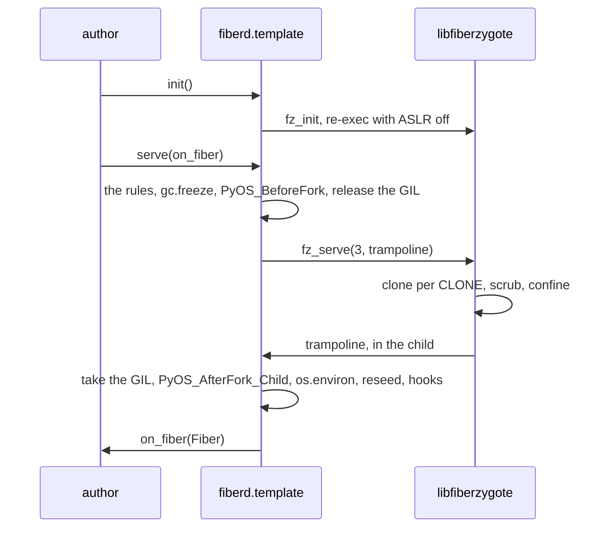

# Design: SDK

This doc explains the SDK under `sdk/`, the two edges other people's code touches, and the rules a template written in a language with a runtime must keep. It is for template authors and readers of `sdk/python`. Read [zygote.md](zygote.md) first. libfiberzygote is the one implementation of the template side, and every other language binds its C API.

## Purpose

A [template](../glossary.md#template) author writes code that runs inside a [fiber](../glossary.md#fiber), and a caller writes code that asks for one. `sdk/c/template` is the template side's C ABI, `libfiberzygote.h`, which `FZ_ABI_VERSION` names and every binding checks at build time. The library behind it is a static archive, built from Rust, that a binding links. `sdk/go/client` is the Go client. `sdk/python` binds the library as a CPython extension, `fiberd._zygote`, built against the limited API so one wheel serves every CPython from 3.14, and puts `fiberd.template` over it. The extension's C glue is compiled with the same hardening flags as the Makefile's `ZYGOTE_CFLAGS` and links the same archive refzygote does. `fiberd.client` is the Python client, the messages generated from `api/grant/v1/grant.proto` (`make python-proto`, checked for drift in CI), the seven stubs written by hand, and one wrapper mirroring the Go client in sync and `grpc.aio` form. It needs the `client` extra (grpcio and protobuf), so a template never pulls them, and it reads a miss off the status trailer with a wire walker of its own rather than grpcio-status.

`sdk/typescript` is the Node.js client, `@fiberd/client`, over grpc-js. Its messages and stubs come from the same grant proto (`make typescript-proto`, checked for drift in CI), and it reads misses from the `google.rpc.Status` trailer. Calls return promises, Watch is an async iterator, and uint64 values stay `bigint`. Handoff trusts the Clone's certificate and checks its SPKI pin before returning the socket. [Its README](../../sdk/typescript/README.md) covers usage.

## How it works

**The fork.** The library forks with a raw `clone3` and runs no atfork handler. The child is a byte copy of the one thread that called `fz_serve`, with the GIL released. `serve()` runs `PyOS_BeforeFork` once in the zygote, flushes stdio, collects and freezes the garbage collector so warm pages are not copied for nothing, releases the GIL and blocks in `fz_serve`. In each child the C trampoline takes the GIL back, runs `PyOS_AfterFork_Child`, which reinitialises the GIL and the runtime locks and runs every `os.register_at_fork` hook, rebuilds `os.environ` from the scrubbed C `environ`, then calls the author's `on_fiber` with a `Fiber`. When fiberd closes the channel, `fz_serve` returns and the zygote runs `PyOS_AfterFork_Parent`.

**The session.** The CLONE line carries the session the caller named, hex so it may hold any character, and the fiber finds it as `Fiber.session` and `FIBERD_SESSION`. For an anonymous fiber the attribute is empty and the variable is unset.

**Incarnations.** Every copy of the template holds its random state, and a fork is not the only copy. A [park](../glossary.md#park) is cooperative, as refzygote does it. `Fiber.serve` answers the park's `SIGUSR1` between connections. It closes the listener, tells fiberd the fiber serves nothing (`fz_quiesce`) and waits for the resume's record (`fz_incarnation_wait`), in select slices with `stopping` checked, since the library's wait blocks through anything a Python handler does. A handler blocked in a read on a quiet client would keep the fiber from answering, since the interpreter retries a read the signal interrupted, so the signal handler shuts down the connection in hand and the read ends as the peer's close. The resumed fiber is reseeded, listens again and reports ready, which acks the record, and fiberd routes it only then. An author running their own loop over `listen()` watches `parking` and calls `park()` the same way. When fiberd gives up waiting for the park, or its dump fails, `park()` returns False and the fiber listens again and serves on as it was. On every incarnation the SDK reseeds `random`, every `random.Random` registered with `register_random`, and OpenSSL through `ssl.RAND_add`, then runs the `@on_incarnation` hooks in registration order with an `Incarnation(kind, generation, fence, seed)` whose seed is zeroed afterwards. The seed is the host's 32 bytes from the record the library read, at birth, at a gVisor restore or at a resume, and the SDK zeroes the one copy the binding made while the binding zeroes the library's. The kind is `fork`, `resume` or, on gVisor, `restore`. The generation is fiberd's count of the lineage, not a count of the process. A fork, a restore of the template image or a pooled hand-out is 1. A resume is the parked generation plus one, which fiberd keeps in the park's manifest, so a session moved to another home counts on. The number arrives on the record on every backend.

**gVisor.** Nothing forks there. `serve()` notices a sandbox by what it was given, no control socket at descriptor 3 and the Sentry's `/proc/gvisor/checkpoint`, and runs refzygote's `gvisor_main` in Python instead. It touches `/host/warm.ready`, blocks in the checkpoint read, and in every sandbox restored from the image takes its incarnation record on fiberd's channel (`fz_gvisor_identity`), reseeds from the host's 32 bytes mixed with the kernel's, runs the hooks and calls `on_fiber`. `ready()` is `fz_gvisor_ack` there. A pooled sandbox waits in `fz_gvisor_identity` until it is handed out, and a park comes back the same way with kind `resume`. The park's `SIGUSR1` sets `stopping`, `serve` returns with the endpoint closed and unlinked, and the loop waits for the next checkpoint. `init()` tells the library nothing there, since no layout is pinned, and the fork rules below are not checked, since a restored sandbox carries its threads and descriptors with it. The record carries the session, so `Fiber.session` is the same on every backend.

**Handoff.** A [handoff](../glossary.md#handoff) fiber listens on nothing. `accept()` takes the next connection fiberd passed down the channel and returns it as an `ssl.SSLSocket`, with TLS 1.3 terminated under the grant's identity. `serve()` does the same for each connection. `accept()` raises `ConnectionResetError` at release and when the fiber is asked to stop. The SDK writes the key and certificate to a sealed memfd and loads them through `/proc/self/fd`, so the key is never a file. `ssl` has no verify callback, so the fiber makes the bound caller's certificate, which the incarnation record carries, the context's one trust anchor, with `VERIFY_X509_PARTIAL_CHAIN` so OpenSSL takes a leaf as one. Any other certificate fails the handshake, with or without the home's CA behind it. The thumbprint is checked again after the handshake.

**Async.** `on_fiber` may be `async def`. It runs under `asyncio.run` in the fiber, so the loop is born after the fork. `serve_async(handler)` then runs `handler(reader, writer)` for each connection, over `asyncio.start_unix_server`, `start_server` or the handoff channel. `connections()` is the async `accept()`, and waits on the channel with `loop.add_reader`.

**Uploads.** The Go and Python clients send an upload as a header, then chunks of at most 1 MiB. The message that completes the declared size waits until the source is read once more and found to end there. For an empty file the Go client opens no stream until then, and the Python client holds back the header. A source that is short or long cancels the call, so fiberd never places a file that does not match its source.

## Backends

| Backend | The template is | How a fiber is born | Park and resume | Run from |
| --- | --- | --- | --- | --- |
| proc | a zygote on fiberd's control socket | a fork with the hooks above | CRIU, the resume record on the channel reseeds | any CPython with the package installed |
| runc | the same zygote as the init of the grant's container, which appends `--log /host/zygote.log` to the command | the same fork, in the container's user namespace | the same, with the container's mounts named external | a rootfs with CPython and the package in it |
| gVisor | the sandbox's init, checkpointed once warm | a restore of that image, identity on the channel | `runsc checkpoint`, the identity reseeds | the same rootfs, read-only |

`hack/python/rootfs.sh` builds that rootfs for the conformance and integration runs from the dev image's PAC-free CPython (`docker/dev/Dockerfile`). A template of one's own on runc or gVisor is an [artifact](artifact.md) built from a Python image plus the package.

## The rules serve() enforces

Each refusal is a `TemplateError` whose message names the rule and the fix, and a template that breaks one never warms.

| Rule | Check | Why |
| --- | --- | --- |
| `init()` ran, before any thread | a flag set in this process, and `/proc/self/task` at `init()` | `fz_init` re-execs to turn ASLR off and takes the mount namespace, both of which need one thread |
| one thread | `/proc/self/task` has one entry. The refusal names each other thread's `comm` and tid | a lock another thread holds at the clone stays held in the copy forever. OpenBLAS, tokenizers, torch, grpcio and uvloop start threads the `threading` module never sees |
| no live descriptor but stdio and the control socket | `/proc/self/fd` holds no socket, pipe, epoll, eventfd, timerfd or signalfd. A regular file is a warning, a memfd is fine | the scrub closes every inherited descriptor in the fiber, so a Python object over one is a dangling wrapper. A memory map survives its descriptor |
| the main thread | `threading.main_thread()` | signals and `PyOS_AfterFork_Child` assume it |
| the GIL | `sys._is_gil_enabled()` | abi3 does not cover a free-threaded build, and the rules above assume the GIL |

`serve(threads="warn")` turns the one-thread refusal into a warning, for an author who stops their pools around clones. It is unsupported. Clients, pools and loops are made in `on_fiber`, where they are one fiber's own, and a fiber never forks again.

## Security notes and known gaps

- The string hash seed is set at interpreter start and shared by every fiber of a template, the prefork trade-off every Python server makes.
- A CPython fiber dirties about 2 MiB at birth before it does any work, since every reference count it touches copies a warm page. Measured on proc as the fiber leaf's `memory.current` right after the Clone, with the conformance template (`fiberd.template.ref --heap-mb 32`), it is 2.25 MiB on 3.14 (four fibers, the median of three runs after a discarded warm-up, on the arm64 dev container at load 0.67). A grant's W budget must leave room for that, and the Python conformance run sets 8 MiB where the C one sets 1 MiB.
- A `threads="warn"` template can deadlock a fiber, and the SDK cannot tell.
- The Python and TypeScript clients trust the fiber's certificate from the Clone (`server_cert`) as their one anchor and check the key pin after the handshake. TypeScript checks it in `checkServerIdentity`, before `secureConnect`, and supplies no TLS session to reuse. A Python handoff fiber trusts the bound caller's certificate the same way. These pin checks are a second look, not the first. Neither client stores or logs the grant token or reads it from the environment.
- A regular file open at `serve()` is closed in the fiber while its Python object thinks it is open.
- On arm64 a parked Python fiber is restored with the interpreter's own pointer-authentication state, which the SDK's objects avoid and the interpreter's may not. The dev image's live userland is sid's, built with branch protection (`libc.so.6` counts 5009 PAC instructions and `python3.14` 16448), and what happens on restore depends on the backend. CRIU 4.2.1 puts the keys back (`NT_ARM_PACA_KEYS`), and measured on the arm64 dev container (a `paca pacg` CPU under Linux 6.12) a fiber of that signed interpreter parks and resumes on proc, so the proc conformance and integration runs use it as it is. gVisor does not. Against sid's libc, `hack/dev/gvisor-check.sh` restores a sandbox that never continues, and against the PAC-free sysroot one that does. So the rootfs for runc and gVisor is built from the dev image's PAC-free CPython 3.14.8 (python.org's tarball, `-mbranch-protection=none`, against bookworm's glibc kept as a sysroot, `_ssl` on the no-asm OpenSSL), and `hack/python/rootfs.sh` counts the PAC instructions in the interpreter, its loader, every stdlib module, the extension and every library it copies, and refuses on one. runc restores through CRIU and would not mind, but shares that rootfs.
