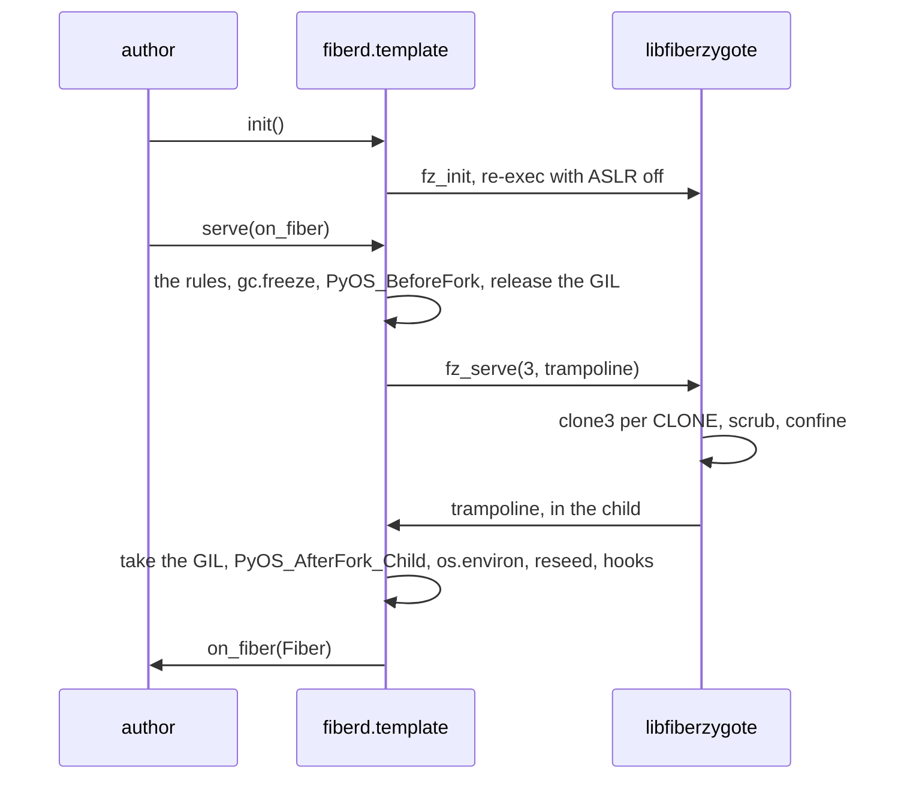

# Design: SDK

This doc explains the SDK under `sdk/`, the two edges other people's code touches, and the rules a template written in a language with a runtime must keep. It is for template authors and readers of `sdk/python`. Read [zygote.md](zygote.md) first, since the C library is the one implementation of the template side and every other language binds it.

## Purpose

A [template](../glossary.md#template) author writes code that runs inside a [fiber](../glossary.md#fiber), and a caller writes code that asks for one. `sdk/c/template` is the template side's C ABI, `libfiberzygote.h`, which `FZ_ABI_VERSION` names and every binding checks at build time. `sdk/go/client` is the Go client. `sdk/python` binds the C library as a CPython extension, `fiberd._zygote`, built against the limited API so one wheel serves every CPython from 3.10, and puts `fiberd.template` over it. The extension is compiled with the same hardening flags as the Makefile's `ZYGOTE_CFLAGS`, so a Python template's library is as hardened as refzygote.

## How it works

**The fork.** The library forks with a raw `clone3` and runs no atfork handler. The child is a byte copy of the one thread that called `fz_serve`, with the GIL released. `serve()` runs `PyOS_BeforeFork` once in the zygote, flushes stdio, collects and freezes the garbage collector so warm pages are not copied for nothing, releases the GIL and blocks in `fz_serve`. In each child the C trampoline takes the GIL back, runs `PyOS_AfterFork_Child`, which reinitialises the GIL and the runtime locks and runs every `os.register_at_fork` hook, rebuilds `os.environ` from the scrubbed C `environ`, then calls the author's `on_fiber` with a `Fiber`. When fiberd closes the channel, `fz_serve` returns and the zygote runs `PyOS_AfterFork_Parent`.

**The session.** The CLONE line carries the session the caller named, hex so it may hold any character, and the fiber finds it as `Fiber.session` and `FIBERD_SESSION`. For an anonymous fiber the attribute is empty and the variable is unset.

**Incarnations.** Every copy of the template holds its random state, and a fork is not the only copy. `Fiber.serve` checks the fence file fiberd publishes beside the endpoint before each connection, as refzygote does, so a fiber resumed from a [park](../glossary.md#park) is reseeded before it serves. On every incarnation the SDK reseeds `random`, every `random.Random` registered with `register_random`, and OpenSSL through `ssl.RAND_add`, then runs the `@on_incarnation` hooks in registration order with an `Incarnation(kind, generation, fence, seed)` whose seed is zeroed afterwards. The gVisor restore kind comes with the gVisor stage.

## The rules serve() enforces

Each refusal is a `TemplateError` whose message names the rule and the fix, and a template that breaks one never warms.

| Rule | Check | Why |
| --- | --- | --- |
| `init()` ran, before any thread | a flag set in this process, and `/proc/self/task` at `init()` | `fz_init` re-execs to turn ASLR off and takes the mount namespace, both of which need one thread |
| one thread | `/proc/self/task` has one entry. The refusal names each other thread's `comm` and tid | a lock another thread holds at the clone stays held in the copy forever. OpenBLAS, tokenizers, torch, grpcio and uvloop start threads the `threading` module never sees |
| no live descriptor but stdio and the control socket | `/proc/self/fd` holds no socket, pipe, epoll, eventfd, timerfd or signalfd. A regular file is a warning, a memfd is fine | the scrub closes every inherited descriptor in the fiber, so a Python object over one is a dangling wrapper. A memory map survives its descriptor |
| the main thread | `threading.main_thread()` | signals and `PyOS_AfterFork_Child` assume it |
| the GIL | `sys._is_gil_enabled()` | abi3 does not cover a free-threaded build, and the rules above assume the GIL |

`serve(threads="warn")` turns the one-thread refusal into a warning, for an author who stops their pools around clones. It is unsupported. Clients, pools and loops are made in `on_fiber`, where they are one fiber's own, and a fiber never forks again.

## Security notes and known gaps

- The string hash seed is set at interpreter start and shared by every fiber of a template, the prefork trade-off every Python server makes.
- A CPython 3.11 fiber dirties about 2.5 MiB at birth before it does any work, since every reference count it touches copies a warm page, and the kernel charges its page tables. A grant's W budget must leave room for that, and the Python conformance run sets 8 MiB where the C one sets 1 MiB. Immortal objects in 3.12 lower it, and the numbers are measured, not assumed.
- A `threads="warn"` template can deadlock a fiber, and the SDK cannot tell.
- A regular file open at `serve()` is closed in the fiber while its Python object thinks it is open.
- On arm64 a parked Python fiber is restored with the interpreter's own pointer-authentication state, which the SDK's objects avoid and the interpreter's may not. Debian bookworm's CPython, the dev image's, carries none, and a Python fiber parks and resumes on the arm64 dev container. An interpreter built with branch protection traps on a FEAT_FPAC CPU, and the gVisor stage measures that before a Python template is called `FIBER_CHECKPOINT` there.
