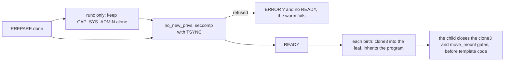

# Design: the fiber filter

This doc explains the seccomp program every proc and runc [zygote](../glossary.md#zygote) installs, and what it refuses a [fiber](../glossary.md#fiber). It is for reviewers of fiber isolation and readers of `sdk/c/template/core/src/seccomp.rs`. Read [zygote.md](zygote.md) first.

## Purpose

A proc or runc fiber shares the host kernel. Capabilities and namespaces keep it from the host's resources, but many kernel interfaces ask for no capability at all and are the usual way into the kernel. The filter refuses those. It is a second layer behind the issuer's TRUSTED mark, not a tenant boundary.

## How it works

The zygote installs one program before READY, on every thread, so an engine thread started earlier is covered too. The zygote and every fiber run under it. Each child then adds a small filter of its own that answers `clone3` with ENOSYS and `move_mount` with EPERM from any address, before template code runs. A child that cannot add it ends with exit 126. CRIU dumps and restores both, so a resumed fiber keeps them, in the fresh user namespace a runc restore puts it in too. A zygote that cannot install its program sends `ERROR ? seccomp filter: <reason>` instead of READY.

The program allows by default. A refusal is an errno and not a kill, because libraries probe and fall back (glibc without `clone3`, libuv without io_uring).

| Refused | Answer |
| --- | --- |
| `clone` and `unshare` with a namespace flag other than CLONE_NEWPID and CLONE_NEWNS, which the legacy birth uses, and `setns` | EPERM |
| `clone3` in the zygote, except from the library's own birth instruction, and in a fiber from any address | ENOSYS |
| `move_mount` in a fiber from any address | EPERM |
| `socket` of a family other than AF_UNIX, AF_INET, AF_INET6 and AF_NETLINK | EAFNOSUPPORT |
| netlink other than NETLINK_ROUTE and NETLINK_GENERIC | EPROTONOSUPPORT |
| `personality` other than the query, PER_LINUX and PER_LINUX32, with or without ADDR_NO_RANDOMIZE | EPERM |
| io_uring, `bpf`, `userfaultfd`, `perf_event_open`, the keyring calls, `memfd_secret`, `lsm_set_self_attr` | EPERM |
| `file_setattr`, and `ioctl` with `FS_IOC_FSSETXATTR` or `FS_IOC_SETFLAGS`, which change a file's project quota | EPERM |
| `ptrace`, `process_vm_readv` and `process_vm_writev`, `kcmp`, `pidfd_getfd` | EPERM |
| the host's calls (modules, kexec, reboot, swap, `syslog`, clocks, host and domain names, quotas, `acct`, `fanotify_init`) | EPERM |
| another architecture, or an x86_64 number with the x32 bit, which numbers these calls differently | the process is killed |

**runc.** With `FIBERD_USERNS_NESTED=deny`, which the runc launcher sets, the zygote first writes 0 to `user.max_user_namespaces` in its own user namespace, and refuses to in the initial one. It then keeps CAP_SYS_ADMIN alone, in the bounding, effective and permitted sets, with inheritable and ambient empty. A runc fiber needs that one for its park ([user-namespaces.md](user-namespaces.md)). Its program also refuses the mount family with EPERM, since that capability would allow it. That is `mount`, `umount2`, `pivot_root`, `chroot`, `open_tree`, `move_mount`, the `fs*` calls, `mount_setattr`, `open_tree_attr`, `name_to_handle_at` and `open_by_handle_at`. `move_mount` is gated like `clone3` (below). It passes from the library's one instruction that moves a child's workspace to `/workspace`, which runs before the child's filter. A refused step sends `ERROR ? capabilities: <reason>` instead of READY.

## Why clone3 is gated

seccomp reads registers, never memory. `clone3` keeps its flags in a struct, so no filter can refuse `clone3(CLONE_NEWUSER)` and pass the rest. Yet CLONE_INTO_CGROUP exists only in `clone3`, and it puts a child in its [leaf](../glossary.md#cgroup) at the fork. Without it each child writes its leaf's `cgroup.procs`. That takes `cgroup_mutex` and the fork rwsem, whose write side can wait out an RCU grace period, so every birth on the node queues behind it.

So the zygote's program allows `clone3` only when `seccomp_data.instruction_pointer` points just past the library's own `clone3` instruction in `birth`. The install reads that address and writes it into the program. The child filter then closes the instruction to every fiber. The runc program gates `move_mount` the same way. A runc fiber holds CAP_SYS_ADMIN over its own mount namespace, so the kernel alone would let it unmount or move its workspace. A runc fiber without a workspace shares the container's namespace, where it could move `/host` or `/sys` under its siblings. So every child of both backends closes both gates, with or without a workspace.

| Who calls `clone3` | Zygote program | Child filter | Result |
| --- | --- | --- | --- |
| the library's birth, in the zygote | allowed | none | the child is born in its leaf |
| any other code in the zygote, such as libc starting an engine thread | ENOSYS | none | ENOSYS |
| a fiber, from any address | allowed at the instruction | ENOSYS | ENOSYS |

The child's install is one small filter and takes no node-wide lock, so births do not queue on each other.

| Alternative | Why it lost |
| --- | --- |
| Refuse `clone3` everywhere | Every birth writes `cgroup.procs`. On CI's amd64, storms ran 65 to 84% slower and 50-way bursts 30 to 40% slower |
| The address check alone | Every fiber has the same instruction at the same address. It can jump there, or exec a binary with a system call there |
| The child filter alone | The zygote's other threads could call `clone3(CLONE_NEWUSER)` |
| `favordynmods` on the host's cgroup2 mount | It removes the grace period but not the `cgroup_mutex` queue, slows every fork on the host, and is not fiberd's to set |

## Security notes and known gaps

- The filter is a denylist. It narrows the kernel's unprivileged surface, and a new call is allowed until it is named. `ioctl` passes except for the two commands that change a file's project quota, so a proc fiber cannot leave its workspace disk budget. A proc fiber owns its files in the initial user namespace, where `fs/fileattr.c`'s `fileattr_set_prepare` lets an owner set `fsx_projid` and toggle `FS_XFLAG_PROJINHERIT`. `FS_IOC_FSSETXATTR` and its syscall twin `file_setattr` set the project id, and `FS_IOC_SETFLAGS` clears `PROJINHERIT` on a directory so new files land in project 0. A runc fiber is in a nested user namespace, where the same kernel check refuses the change with EINVAL, so it is already safe. Its program refuses these too, since it is the fiber program plus the mount family. gVisor and Hyperlight fibers never reach the host kernel's `fileattr` path.
- On proc the program does not filter the mount calls, since each child mounts its own `/proc` after the clone. A proc fiber has no capability to mount.
- Capabilities belong to a thread. On runc, an engine thread the template starts before `fz_serve` keeps the container's set. No fiber inherits it, since every fiber forks from the serving thread.
- The address check refuses the zygote's ordinary `clone3` and, on runc, `move_mount` calls, not code built to jump to the library's instructions. Such code is the template's own, behind the TRUSTED mark.
- gVisor and Hyperlight fibers get no filter. Their boundary is the Sentry and the hypervisor.
