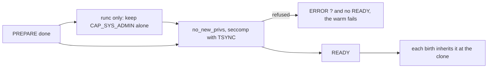

# Design: the fiber filter

This doc explains the seccomp program every proc and runc [zygote](../glossary.md#zygote) installs, and what it refuses a [fiber](../glossary.md#fiber). It is for reviewers of fiber isolation and readers of `sdk/c/template/core/src/seccomp.rs`. Read [zygote.md](zygote.md) first.

## Purpose

A proc or runc fiber shares the host kernel. Capabilities and namespaces keep it from the host's resources, but many kernel interfaces ask for no capability at all and are the usual way into the kernel. The filter refuses those. It is a second layer behind the issuer's TRUSTED mark, not a tenant boundary.

## How it works

The zygote installs one program before READY, on every thread, so an engine thread started earlier is covered too. The zygote and every fiber run under it, and a birth pays nothing for it. CRIU dumps and restores it, so a resumed fiber keeps it, in the fresh user namespace a runc restore puts it in too. A zygote that cannot install it sends `ERROR ? seccomp filter: <reason>` instead of READY.

The program allows by default. A refusal is an errno and not a kill, because libraries probe and fall back (glibc without `clone3`, libuv without io_uring).

| Refused | Answer |
| --- | --- |
| `clone` and `unshare` with a namespace flag other than CLONE_NEWPID and CLONE_NEWNS, which birth uses, and `setns` | EPERM |
| `clone3`, whose flags seccomp cannot read, so libc and birth fall back to `clone` | ENOSYS |
| `socket` of a family other than AF_UNIX, AF_INET, AF_INET6 and AF_NETLINK | EAFNOSUPPORT |
| netlink other than NETLINK_ROUTE and NETLINK_GENERIC | EPROTONOSUPPORT |
| `personality` other than the query, PER_LINUX and PER_LINUX32, with or without ADDR_NO_RANDOMIZE | EPERM |
| io_uring, `bpf`, `userfaultfd`, `perf_event_open`, the keyring calls, `memfd_secret`, `lsm_set_self_attr` | EPERM |
| `ptrace`, `process_vm_readv` and `process_vm_writev`, `kcmp`, `pidfd_getfd` | EPERM |
| the host's calls (modules, kexec, reboot, swap, `syslog`, clocks, host and domain names, quotas, `acct`, `fanotify_init`) | EPERM |
| another architecture, or an x86_64 number with the x32 bit, which numbers these calls differently | the process is killed |

**runc.** With `FIBERD_USERNS_NESTED=deny`, which the runc launcher sets, the zygote first writes 0 to `user.max_user_namespaces` in its own user namespace, and refuses to in the initial one. It then keeps CAP_SYS_ADMIN alone, in the bounding, effective and permitted sets, with inheritable and ambient empty. A runc fiber needs that one for its park ([user-namespaces.md](user-namespaces.md)). Its program also refuses the mount family with EPERM, since that capability would allow it. That is `mount`, `umount2`, `pivot_root`, `chroot`, `open_tree`, `move_mount`, the `fs*` calls, `mount_setattr`, `open_tree_attr`, `name_to_handle_at` and `open_by_handle_at`. A refused step sends `ERROR ? capabilities: <reason>` instead of READY.

## Security notes and known gaps

- The filter is a denylist. It narrows the kernel's unprivileged surface, a new call is allowed until it is named, and `ioctl` is not filtered.
- On proc the mount calls are not filtered, since each child mounts its own `/proc` after the clone. A proc fiber has no capability to mount.
- Capabilities belong to a thread. On runc, an engine thread the template starts before `fz_serve` keeps the container's set. No fiber inherits it, since every fiber forks from the serving thread.
- gVisor and Hyperlight fibers get no filter. Their boundary is the Sentry and the hypervisor.
