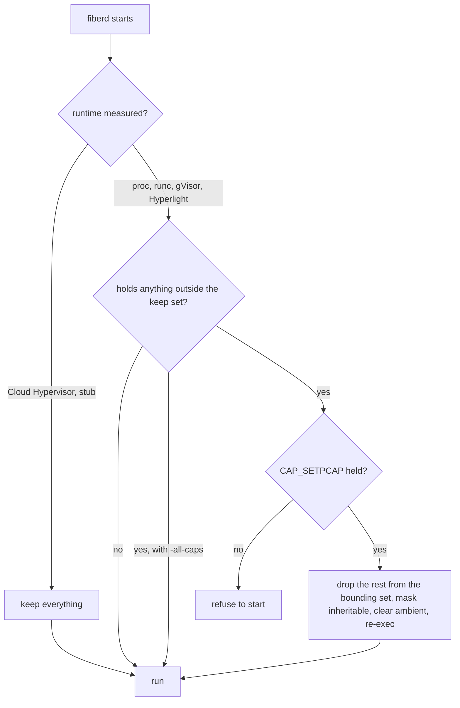

# Design: sys

This doc explains the Linux pieces every [backend](../glossary.md#backend) leans on. They are [cgroup](../glossary.md#cgroup) v2 leaves, [CRIU](../glossary.md#criu) dump and restore, the mounts a container leaves read-only, capability narrowing, network namespace entry and helper starts. It is for readers of `pkg/sys` and anyone auditing [fiberd](../glossary.md#fiberd)'s privileges. Read [backends.md](backends.md) first.

## Purpose

The backends share six needs that are not about any one sandbox. A [fiber](../glossary.md#fiber) must be born into a cgroup leaf the host can meter and kill. A process tree must be dumped and brought back with the mounts it did not make. Both need files that an unprivileged container mounts read-only. fiberd must run with as few capabilities as its [backend](../glossary.md#backend) needs. A socket must be made inside another process's network namespace. A program fiberd starts must see only what fiberd chose. `pkg/sys` holds each as plain file operations and system calls.

## How it works

**cgroup.** Whatever starts fiberd, a kubelet, a Slurm step or a shell, puts it in some cgroup. `Delegate` moves every process there into a `fiberd` leaf, because a cgroup with processes may enable no controllers for its children, then enables `memory` and `pids` in `cgroup.subtree_control` and hands back a `grants` subtree. A controller the parent does not offer is skipped, and memory is required. The limit the starter put on the root stays the ceiling on everything below, and the runtime caps its subtree a reserve under it so fiberd's own leaf keeps room ([resources.md](resources.md)). Under the subtree the runtime makes one leaf per fiber ([resources.md](resources.md) has its limits), opens it as a descriptor for the birth, and reads `memory.current`, one `memory.stat` counter, `memory.pressure` ([PSI](../glossary.md#psi)) and `memory.events`. `cgroup.kill` ends a leaf whole.

**criu.** `DumpWith` runs `criu dump` on one tree with `--ext-unix-sk` and `--manage-cgroups=ignore`. When the host wants the tree to end only once the images are durable, the dump leaves it running. `Available` needs criu 4.2 or later before it runs `criu check` ([backends.md](backends.md) says why). `RestoreWith` starts `criu restore` inside the cgroup descriptor it is given, so the tree lands in its new leaf. A restore can run through a wrapper command that makes mounts of its own and then execs criu, as the runc backend's does for `/sys` ([user-namespaces.md](user-namespaces.md)). criu stays as the tree's parent, and its exit is the fiber's. A tree with a mount namespace of its own carries mounts it did not make. `DumpMounts` records every single-file mount by name beside the images and passes each as `--external mnt[path]:name`, because criu's automatic detection dumps them but cannot restore them. `RestoreMounts` reads the record and binds each name back under `--root`, a bind of the host's `/`. The runc launcher names its own external mounts instead ([backends.md](backends.md)).

**helper.** fiberd starts `criu`, `runc`, `runsc`, `ldd` and the VMM's version check through `helper.Command`. A bare name is found in a fixed list of directories, never on `PATH`, and an absolute name passes through. A relative path is refused. The helper's environment is `PATH=/usr/bin:/bin` and nothing else. A helper that runs through a wrapper is resolved first, because that `PATH` does not reach every directory in the list. fiberd's own environment stays as it started, since an operator's proxy settings live there. The Hyperlight helper is the one exception. A deployment's settings reach it through the environment, so it keeps the container's whole environment. Its runtime keeps no capabilities, and on a home with a device [engine](../glossary.md#engine) it holds the four fiberd keeps for the engine. fiberd refuses a relative `-hyperlight-helper`, `-hyperlight-guest` or `-cloudhv-vmm` path at start, and a bare name counts as relative. A relative path means something else in the grant's run directory, where the Hyperlight helper runs, and a bare VMM name could be one file to the version check and another to the [jail](cloudhv.md).

**mounts.** An unprivileged container gets `/sys/fs/cgroup` and `/proc/sys` read-only. `Prepare` runs at start, before narrowing, because it needs SYS_ADMIN. It remounts a read-only cgroup mount read-write as a bind remount, so only that mount point changes, and keeps nosuid, nodev and noexec. CRIU writes four sysctls during a restore, `ns_last_pid`, `msg_next_id`, `sem_next_id` and `shm_next_id` under `/proc/sys/kernel`. Each read-only one is bound onto itself and that mount alone is made writable, so the rest of `/proc/sys` stays read-only. A mount that is already writable is left alone, so on a plain host `Prepare` does nothing.

**caps.** A process started as root gets exactly its bounding set, and one that execs a file with inheritable file capabilities gets what the inheritable and ambient sets allow. `Narrow` drops everything outside the keep set from the bounding set on one locked thread, masks the inheritable set to the keep set, empties the ambient set and re-executes `/proc/self/exe`, so the new process starts with those sets on every thread. Nothing is ever added. A keep set is measured by running the runtime's integration or conformance suite under `setpriv` with each candidate left out. `hack/test/caps.sh` does this for any runtime. Measure on a host with Yama, such as a CI runner through the `caps` workflow, or the run misses SYS_PTRACE.

| Runtime | Keeps | Why |
| --- | --- | --- |
| proc (7) | SYS_ADMIN, SYS_CHROOT, SYS_TIME, NET_ADMIN, SETPCAP, SYS_PTRACE, SYS_RESOURCE | Namespaces, mounts and cgroups. CRIU restoring a fiber's mount and time namespaces, and TCP repair. The [zygote](../glossary.md#zygote) emptying each fiber's bounding set. CRIU attaching to fibers it did not start, which Yama's default `ptrace_scope` 1 allows only with SYS_PTRACE, and raising its open-file limit |
| runc (11) | the seven plus CHOWN, DAC_OVERRIDE, SETGID, SETUID | runc writes the mapped root's id maps and chowns `exec.fifo` to it. runc, criu and fiberd open files the mapped root owns with modes that keep root out. KILL is not needed, since fibers and the container's init end through their cgroups |
| gVisor (4) | SYS_ADMIN, SETGID, SETUID, SETFCAP | SYS_ADMIN mounts the templates tmpfs and makes the sandbox's namespaces. Without any one of the other three, runsc cannot fork and exec its gofer process. The Sentry serves the fibers' syscalls and CRIU is not involved, so nothing proc keeps for CRIU is needed |
| Hyperlight (0) | nothing | The helper opens `/dev/kvm` by its file mode, and the guest is behind the hypervisor |

A home with a device [engine](../glossary.md#engine) keeps CHOWN, SETUID, SETGID and SETPCAP on top of its runtime's set. The engine's directory goes to its uid, its process drops to that uid and gid, and its bounding set is emptied before its exec.

fiberd re-executes with its keep set unless `-all-caps`. One that holds more but lacks SETPCAP refuses to start rather than run with everything.

**netns.** A unix socket belongs to the namespace it was created in, and criu finds only the sockets of the namespaces it dumps. `Do` locks an OS thread, enters the network namespace of a pid with `setns`, runs a function and returns. A thread that cannot return is left locked to a goroutine that ends, so the runtime discards it instead of handing it to other goroutines. `Socketpair` makes a fiber's channel there, and `LoopbackUp` brings `lo` up in a namespace criu created empty.

## Security notes and known gaps

- SYS_ADMIN is broad. Namespaces, mounts and cgroups need it, and it covers far more. The fibers hold none of it on proc, and on runc only inside their user namespace.
- Cloud Hypervisor and the stub are not measured. With them fiberd keeps the capabilities it started with.
- The measured sets assume fibers run as fiberd's user. A proc [template](../glossary.md#template) that switches user is likely to need more.
