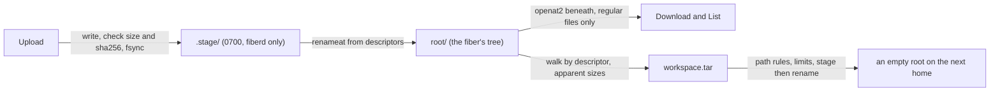

# Design: wsfs

This doc explains the file layer of a [fiber](../glossary.md#fiber)'s workspace, the tree a caller uploads into and downloads from. It is for readers of `pkg/runtime/host/wsfs` and anyone auditing what [fiberd](../glossary.md#fiberd) does as root in a tree a fiber controls. Read [runtime-host.md](runtime-host.md) first. The host runtime opens one workspace per fiber of a grant with a disk budget, serves the file calls on it, captures it at park and unpacks it at resume, and the proc backend mounts its root at `/workspace` in the fiber.

## Purpose

A fiber owns every name under its workspace root. fiberd reads and writes that tree as root, so a planted link, FIFO, device or hard link must never send fiberd's bytes anywhere else, hang it, or pull host bytes into a [delta](../glossary.md#delta). The package does five things and nothing else. It uploads a file, downloads one, lists a directory, captures the tree as `workspace.tar` for a park, and unpacks that archive for a resume.

## How it works

**One descriptor, never a path.** `Open` opens `root` and `.stage` once, and `Close` waits for the operations in flight before it closes them, since the kernel reuses descriptor numbers. Each directory listing opens the directory afresh beneath its descriptor, so two captures at once do not share one offset. Every later name is resolved with `openat2` beneath the root descriptor, with `RESOLVE_BENEATH`, `RESOLVE_NO_SYMLINKS`, `RESOLVE_NO_MAGICLINKS` and `RESOLVE_NO_XDEV`, so a link anywhere on the way, a `/proc` magic link, a step outside or a crossing into another mount is refused. A kernel without `openat2` gets no workspace. The kernel answers `EAGAIN` when a rename races the lookup, and the open is retried a bounded number of times, then refused.

**Paths.** A path is relative, at most 4096 bytes and 64 components, with no NUL, empty, `.` or `..` component. `Clean` is the one checker, for caller paths, every archive name and every hard link target. A symbolic link's target is kept as a string and refused only when it is empty, over 4096 bytes or holds a NUL. `make fuzz` runs Go fuzz targets against `Clean` and the archive reader.

**Upload.** The budget is reserved for the declared size and, for a new name, one entry before a byte lands. Every budget and limit check subtracts from what is left, so a declared size near the maximum cannot wrap a sum and pass. The body goes to a file in `.stage`, which the fiber cannot see. It is cut off at the declared size, a shorter or longer body is refused, the optional sha256 is checked, and the file is synced. Then it is renamed into place from the staging descriptor to the parent's descriptor. A link, FIFO, socket or device at the name is replaced and never followed. A directory at the name is refused. Whatever the name held is pinned by a descriptor first and read again after the rename. When no name is left on it and fiberd wrote it, the bytes reserved for it come back. A file the fiber made gives back nothing, since nothing was reserved for it. Missing directories are made one component at a time, and a component that turns out to be a link or a file is refused. A failed upload leaves nothing behind and releases its reservation.

**Download and capture.** A file is opened as a path first (`O_PATH`), checked to be a regular file, then reopened through its own descriptor and checked again to be the same inode. So a FIFO is never opened for reading and a device node is never opened at all. A reader is bounded by the size at the open. A file the fiber grows afterwards ends at the old size, and one it truncates ends short. The archive carries directories, regular files and symbolic links, the link as its target string. A file with several names in the tree is written once and then as hard links. Only such files are remembered, so a tree without hard links costs no memory here, and at worst the map holds the entry ceiling times the longest path, 256 MiB. A file whose link count exceeds its names in the tree has a name outside, and the capture is refused rather than sealing host bytes into a delta. FIFOs, sockets and devices are skipped. Sparse files count by apparent size, checked before anything of the file is written, so a hole of any size stops the capture at the ceiling. Every path is checked with the same rules `Unpack` applies, so a tree that parks can always resume.

**Unpack.** Only into an empty root. Every name and hard link target passes `Clean`, entries and bytes are counted against the limits and reserved against the budget, regular files go through `.stage` and the same rename, and a hard link may only name a regular file the same archive wrote earlier. A symbolic link is made as a string that nothing here follows, so an archive that plants `d -> /etc` and then writes `d/passwd` is refused at the write. On failure every reservation is released and the caller discards the tree.

**Budget.** `Budget` is a seam. Upload and Unpack reserve before writing and release on failure or when a file fiberd wrote goes away. A failed unpack releases its net reservation, what it took less what replaced names gave back. `Counter` is the in-memory one and the only one. It never clamps, so a release past zero stays visible as a bug. Zero bytes allows no file bytes anywhere, as a zero disk budget gives no workspace.

## Security notes and known gaps

- A hard link from outside the tree cannot be told from one inside by a single download, only by a capture, which counts names. A workspace on its own mount would refuse such a link at creation, since `link(2)` does not cross mounts.
- The fiber's own writes never pass through this layer, so the budget counts only what fiberd writes.
- Entry accounting on upload is best effort. The name is checked before the reservation and the fiber may add or remove it in between. The bytes are exact for what fiberd wrote, and what fiberd wrote is remembered by inode in memory, so a restart forgets it and replacing an older file then gives nothing back.
- The read of exactly the declared size ends when the body does. A stream that keeps the connection open after the last byte holds the upload and its reservation until the transport's idle timeout, which is the RPC layer's to set.
- Ownership of what fiberd writes is `Owner`, applied by descriptor to staged files, to directories made on the way, and to a name fiberd just made only after it is pinned and found to be of the type fiberd made. Which id a backend hands in is that backend's decision.
- Directories made on the way to an upload that then fails stay behind, uncounted.
- Directory modes come back from an archive with the owner's `rwx` added, so the rest of the archive can land inside.
