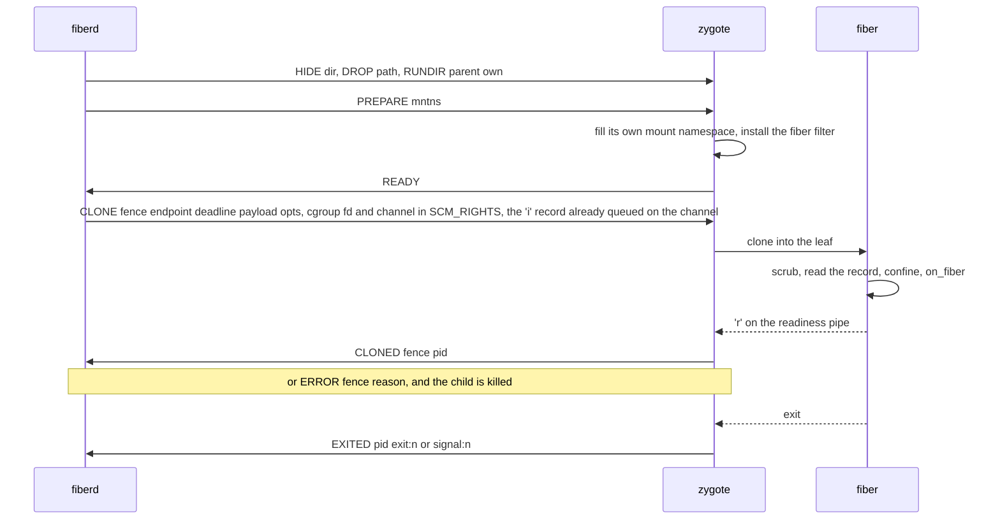

# Design: zygote

This doc explains libfiberzygote, the library a [template](../glossary.md#template) links to become a [zygote](../glossary.md#zygote), and the line protocol it speaks with [fiberd](../glossary.md#fiberd). It is for template authors and readers of `sdk/c/template/` and `pkg/backend/proc`. Read [backends.md](backends.md) first.

## Purpose

A [fiber](../glossary.md#fiber) on the proc and runc [backends](../glossary.md#backend) is a fork of a [warm](../glossary.md#warm) process. The fork must land in the right [cgroup](../glossary.md#cgroup), carry nothing of the zygote's descriptors or environment, be confined as fiberd asked, and report ready under a deadline. A template author should get none of that wrong, so the library does it. The application initialises once, calls `fz_init` first thing in `main` and `fz_serve(3, on_fiber)` when warm, and supplies `on_fiber`, which runs in the child. In the zygote, fd 3 is the control socket fiberd hands it. On gVisor nothing forks, and a template calls `fz_gvisor_identity` and `fz_gvisor_ack` instead ([sdk/c/template/README.md](../../sdk/c/template/README.md)).

## How it works

**The contract.** `FZ_ABI_VERSION` in `libfiberzygote.h` names the ABI, and a binding checks it at build time. `fz_init` turns address-space randomisation off and re-execs, so a fiber's checkpoint can be a [delta](../glossary.md#delta) over the zygote's pages on any [home](../glossary.md#home) warmed from the same artifact, blocks `SIGCHLD` before any thread exists, and with `FIBERD_OWN_MNTNS` set takes the private mount namespace that `fz_serve` fills before READY (see below). A template that skipped `fz_init` is refused at `fz_serve`. `on_fiber` receives `fz_incarnation_t`, the record fiberd queued on the fiber's channel before the CLONE, with the [fence](../glossary.md#fence), the endpoint, the payload, the [session](../glossary.md#session) name, the generation, the kind, a 32-byte seed from the host and a [handoff](../glossary.md#handoff) fiber's TLS identity. A gVisor sandbox gets the same record through `fz_gvisor_identity`. `on_fiber` reseeds from the seed, serves, calls `fz_fiber_ready` once listening, and its return value is the exit code. Until then the child's stderr is the zygote's log, after it stderr is `/dev/null` and the seed is zeroed. In the fiber, fd 3 is the readiness pipe and fd 4 the channel (`FIBERD_CHANNEL_FD`), neither the fiber's to use. A handoff fiber keeps fiberd's channel there and serves `fz_accept` ([handoff.md](handoff.md)). Any other fiber replaces it with a pair of its own, fd 4 to read and fd 5 as the peer, which a park dumps whole. fiberd speaks on the other end, the host's end of a handoff fiber's channel or the peer of any other fiber, borrowed with `pidfd_getfd` for each exchange.

**Park and resume.** A park is cooperative, and every park of a fiber is a round of its own. fiberd queues the round on the channel (`'p'`), sends the fiber `SIGUSR1` and waits for its word, `'q'` with that round, which the template gives with `fz_quiesce` once it has stopped serving, closed its listener and closed every connection it accepted. Only then is the tree dumped. The wait is the grant's resume deadline. A fiber that does not answer in time is not parked, the park fails by name and fiberd tells the fiber so for that round (`'c'`), so a late answer meets its own carry-on and the fiber serves again. The fiber honours a carry-on for the round it answered alone, so none left by a park that gave up undoes a later park's dump. The template blocks in `fz_incarnation_wait` after its answer. After a restore fiberd writes the second record, kind `resume` with the new fence, the next generation and a fresh seed, and the template reseeds, listens again and calls `fz_fiber_ready`, which now acks with `'a'` and the fence. fiberd routes the fiber only after the ack, within the same deadline, and ends a restored tree that never acks. A dump that fails after `'q'` answers `'c'` the same way, and the template serves on as it was. refzygote ends with 122 when it gets no record, on gVisor and after a failed wait.

**The lines.** Each message is one text line on the control socket.

| Line | From | What it says |
| --- | --- | --- |
| REBIND | fiberd, runc only | A new control socket, made inside the container's network namespace so a checkpoint finds it. It comes first |
| HIDE, DROP, RUNDIR | fiberd | Before READY, what every mount-namespace fiber covers, what it unmounts and which one run-directory entry it keeps. DROP names this home's resume restore root, a bind of the host's `/` ([sys.md](sys.md)). Other homes' mounts need no line, since the zygote knows them by what they are (below). The zygote keeps 16 HIDE and 16 DROP paths, each under 4096 bytes (PATH_MAX). One more, or a longer path, is refused, never cut. A refused one ends the zygote with an `ERROR ?` instead of READY, and fiberd fails the warm |
| PREPARE | fiberd | Ends the setup lines. `PREPARE mntns` has the zygote build the view the lines describe in its own mount namespace, once. `PREPARE none`, which the runc launcher sends, says no fiber will ask for a mount namespace. A setup line after READY, or any other line before PREPARE, is a protocol error |
| READY | zygote | The template is warm and its namespace is built. Sent once, after REBIND, the nested-namespace cap when the environment asks for it, PREPARE and the fiber filter. A zygote that could not prepare its namespace or install the filter sends `ERROR ?` with the reason instead and ends. Every fiber of a plain proc grant asks for a mount namespace, so fiberd fails the warm and the home never reports that grant ready |
| CLONE | fiberd | The fence (at most 127 characters), endpoint, deadline, hex payload, hex session (`-` for an anonymous fiber) and options `pidns`, `mntns`, `nocaps` and `ws`. An option the core does not know is refused with ERROR, never skipped, since a fiber born without what it asked for would run with less than fiberd believes. The fiber finds the session as `FIBERD_SESSION`. The leaf's cgroup descriptor, then with `ws` the fiber's workspace, then the fiber's channel ride in SCM_RIGHTS. The workspace is a detached copy of the fiber's root directory (`open_tree` with `OPEN_TREE_CLONE`) that the child moves to `/workspace` in its own namespace before anything else. On proc `ws` needs `mntns`. A runc zygote prepares no namespace, so it takes `ws` alone and gives the child its own copy of the container's mount namespace at the birth. The zygote closes its copy once the child is forked, so no later fiber inherits a descriptor onto another fiber's tree. The record, and the channel's first message, queued before the line, is the record `'i'` with eleven NUL-ended fields. Generation, kind, fence, endpoint, hex payload, hex session, then the key, certificate, caller and caller certificate of a handoff fiber (`-` on any other), then the seed in hex. The child reads it with raw system calls into its own memory before `on_fiber` and refuses one that names another fence. The kind is `fork` and the generation 1, since a fork of the warm template starts a lineage. fiberd counts the lineage from there, and a resume brings a second record of kind `resume` with the parked generation plus one, which `fz_incarnation_wait` hands over |
| CLONED, ERROR | zygote | The new fiber's fence and pid, or why the clone failed |
| EXITED | zygote | A fiber ended, with its exit code or signal |
| DEVICE, EVICT | zygote, fiberd | An [engine](../glossary.md#engine) reports each fiber's device slice with `fz_report_line`, and drops one on EVICT. The template formats the line and the library adds the newline |

**Fork into the leaf.** Every birth is `clone3` with the namespace flags and `CLONE_INTO_CGROUP`, so the child starts in its leaf. The fiber filter lets `clone3` through only from the library's own instruction in birth ([seccomp.md](seccomp.md#why-clone3-is-gated)). On a kernel before 5.7 the birth is the legacy `clone`, and the child writes itself into the leaf's `cgroup.procs` as its first act. A child that cannot ends with exit 125, and no fiber runs charged to the zygote's cgroup.

**Scrub.** The child mounts its workspace first, while every descriptor is still open and its capabilities held, and stacks its own filter next ([seccomp.md](seccomp.md)). Then it closes the zygote's `SIGCHLD` descriptor and every descriptor above its channel, replaces its environment with the few `FIBERD_` entries the zygote built for this fiber, starts a new session and empties its signal mask. A handoff fiber's channel is the one socket a park names external, and a resume gives it a fresh pair end at the same descriptor. Any other fiber's pair is its own, dumped whole. Its queues are empty at every park, since the fiber has taken and acked every record before it says it serves nothing, so no seed lands in the images.

**One namespace, copied per fiber.** Most of a fiber's mount work is the same for every fiber of a grant. Every mount under `/sys` is made read-only, the run directory is narrowed to this grant's entry and the HIDE directories are covered. Doing that in each child cost about 110 to 140 µs per birth, most of it the mountinfo scan and the remounts. The zygote now does it once. `fz_init` calls `unshare(CLONE_NEWNS)` and makes every mount private, before any thread exists, because with a thread already made only the calling thread would move and CRIU refuses a tree whose threads differ in namespace. It does so when `FIBERD_OWN_MNTNS` is in its environment. The proc backend sets it, and the runc launcher and an artifact build do not, since their zygote prepares no namespace and stays in the one it was started in. A runc fiber with a workspace gets a copy of that one, the container's, whose mounts runc made slaves, so its workspace reaches no sibling. At `PREPARE mntns` the zygote, in that namespace, makes `/sys` read-only, unmounts the DROP paths and other fiberd homes' mounts, narrows the run directory and covers the HIDE directories, then says READY. A mount-namespace fiber's birth copies that namespace, so its birth adds only what is its own. Private propagation means a mount the host adds later never reaches the zygote or any fiber. The zygote itself sees other grants' run directories and the hidden paths no more than its fibers do. Every fiber of the grant carries the same mounts with the same flags, so a park dumps and a resume restores the same shape each time, and the zygote's self-checkpoint, the parent for deltas, names its mounts the way a fiber's park does.

**Other homes' mounts.** `unshare` copies the host's whole mount table, including what other fiberd homes in the same mount namespace have mounted, such as a gVisor home's templates tmpfs or another proc home's restore root. No fiber needs those, and they are harmful to carry. A park records them, and once that home has unmounted its mount the resume cannot put it back. A tmpfs that home detached meanwhile stays alive inside every fiber that copied it, with its contents, and the next park writes them into the checkpoint, which for a templates tmpfs is another home's template memory. So before READY the zygote reads its own mountinfo and detaches every mount that is one of fiberd's by what it is, with no path from fiberd. That is a file system whose source starts with `fiberd-` (every file system fiberd mounts is named so, `backend.MountSourcePrefix`), and any bind of `/` other than `/` itself, which is what a restore root is and which would show every hidden path uncovered. Each pass reads the table afresh and takes one mount off, so a table that changes under the read is never misread. A line longer than the zygote's 8 KiB buffer, as an overlay root's is with its `lowerdir` options, is read as far as its source field, which comes before them. One whose fields do not even fit, or a mount that will not go, fails the PREPARE, and the warm with it, rather than let a mount slip by unread. The `/sys` pass reads the table the same way. The pass runs once, since the namespace is private and nothing arrives after it. DROP still names this home's own restore root, which the fiber repeats per birth.

| Step | Where | Why there |
| --- | --- | --- |
| `/sys` read-only, every mount under it, `/sys/firmware` covered | zygote, at PREPARE | Grant-wide. A mount added under `/sys` after that never reaches the private namespace |
| DROP (the restore root) | zygote at PREPARE, and each fiber | Grant-wide, and repeated per fiber because it is one system call and fails closed |
| other fiberd homes' mounts detached (`fiberd-*` sources, binds of `/`) | zygote, at PREPARE | Grant-wide. Copied from the host at `fz_init`, and the private namespace takes in nothing afterwards |
| RUNDIR narrowed | zygote, at PREPARE | Grant-wide. The zygote's cwd moves onto the bind and every fiber inherits it there |
| HIDE covered | zygote, at PREPARE | Grant-wide. Each path is resolved through symlinks first, so the executable inside it is still found. A HIDE directory that did not exist yet is looked for again at each birth and covered then. A HIDE directory that holds the zygote's own executable (the template cache, for a registry template) is covered with the executable bound back at its path, read-only, from a descriptor opened before the cover, since CRIU names a mapped file by a path that must resolve ([runtime-host.md](runtime-host.md)) |
| `MS_REC` `MS_PRIVATE` on `/` | each fiber | The copy is private already. The call restates it, and a refusal ends the child before anything else is mounted |
| fresh `/proc` for the pid namespace | each fiber | Its own |
| `/proc/sys`, `/proc/sysrq-trigger`, `/proc/bus`, `/proc/fs` and `/proc/irq` bound onto themselves and read-only, `/proc/scsi` and `/proc/acpi` covered | each fiber, after its `/proc` | A fiber's fresh `/proc` is a mount of its own and would cover a bind the zygote made, leaving the fiber's `/proc/sys` writable. The list is runc's for a container, and `/proc/sysrq-trigger` takes a write from euid 0 with no capability |
| fiber filter, and on runc CAP_SYS_ADMIN alone | zygote, before READY | Inherited at the clone. Each fiber closes the `clone3` and `move_mount` gates before template code ([seccomp.md](seccomp.md)) |
| capabilities dropped (`nocaps`, every proc fiber) | each fiber | Its own |

**Confinement fails closed.** When a step fiberd asked for is refused, no fiber runs short of it. A step that fails at PREPARE, or a zygote with no namespace of its own (`FIBERD_OWN_MNTNS` unset, `fz_init` skipped, a thread before it, `unshare` refused), sets one reason, and every `mntns` CLONE is answered with an ERROR naming it, while fibers without `mntns` are still served. A step that fails in the child ends it before any application code, with an exit code from 110 to 127 for that step (127 is a workspace that would not mount), and the CLONE is answered with an ERROR naming the step (`exit_why` in `core/src/zygote.rs`).

**Fork safety.** The raw clone copies one thread and runs no atfork handlers, so a lock another thread held at that instant stays held in the copy, malloc's and stdio's included. Between the clone and `on_fiber` the library allocates nothing, takes no lock and uses no stdio, and the fiber's environment is built in the parent before the clone. It reseeds no random generator either, since `srandom` takes a lock. A template reseeds its own in every new run, libc's `random()` included. That is in `on_fiber`, after a gVisor restore and when `fz_incarnation_wait` hands over a resume's record, each time from the record's seed mixed with `getrandom`, as refzygote's `reseed_rngs_from` does ([sdk/c/template/README.md](../../sdk/c/template/README.md)).

**Build flags.** On arm64, build the whole program with `-mbranch-protection=none`. A process gVisor restores keeps stale pointer-authentication keys, so a return address signed before the checkpoint fails to authenticate. CRIU 4.2.1 puts the keys back, so proc and runc restores do not trap. A template's C is built with `-D_FORTIFY_SOURCE=3 -fstack-protector-strong -fstack-clash-protection -fPIE -Wformat=2 -Werror=format-security` and linked with `-pie -Wl,-z,relro,-z,now`, as refzygote is. The library is a static archive cargo builds from `sdk/c/template/core`, with no standard library and no allocator. CI fails if the archive needs an allocator, calls libc outside a short allowlist, or holds a pointer-authentication instruction. Stable Rust has no stack protector ([SECURITY.md](../../SECURITY.md)). The library's tables live in bss and stay under 1 MB, since under THP=always one write faults in a whole 2 MiB window that every park then writes out. `make fuzz` runs the library's cargo-fuzz targets under ASan, two of them against the C parsers the library replaced, with system calls routed to hooks so nothing really mounts or clones.

## Security notes and known gaps

- Fibers run as uid 0 on proc. Confinement is what stands between them and the host, and a file outside the covered paths is protected by its owner's mode alone.
- The record, a handoff fiber's key and the seed included, lives in the fiber's memory, never the zygote's, so no key lands in a template checkpoint, and the seed is zeroed at ready, at the resume's ack and at `fz_seed_forget`, so none lands in a park. Any other record the fiber reads has its seed wiped as it is read. That covers one it refuses or has already served, one too long for its buffer and one that rode with a descriptor. A [parked](../glossary.md#park) fiber's key is in its delta, which is sealed ([artifact.md](artifact.md)). A resume's record can be written by fiberd alone. Borrowing the peer end needs ptrace rights over the fiber, which fiberd holds as root with `CAP_SYS_PTRACE`. A fiber of another grant is the init of a pid namespace where the fiber's pid names nothing, and on runc sits in another grant's user namespace besides, so `pidfd_open` answers it `ESRCH`. A fiber can write on its own peer, which forges nothing it could not do to itself.
- ASLR (address-space layout randomisation) is off, as the contract requires. What that costs is in [security.md](../security.md#known-gaps).
- A HIDE path is covered when a fiber is born. A fiber already running when the host first creates that path can read it. fiberd creates every real HIDE target before any grant warms.
