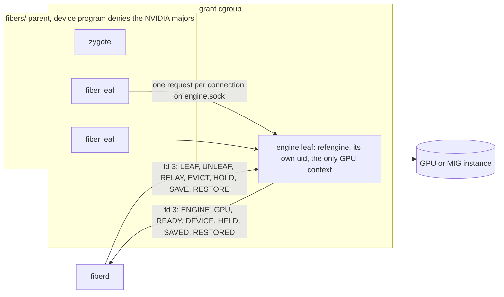
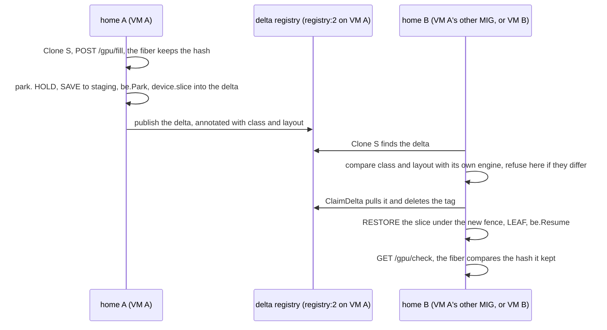
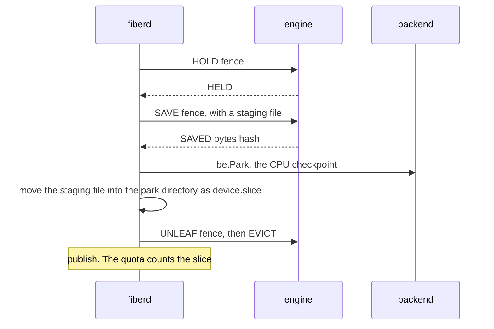
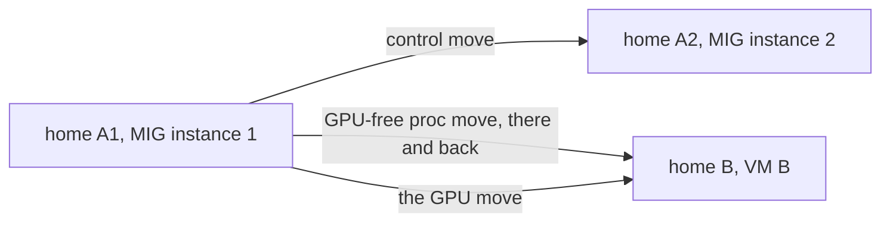
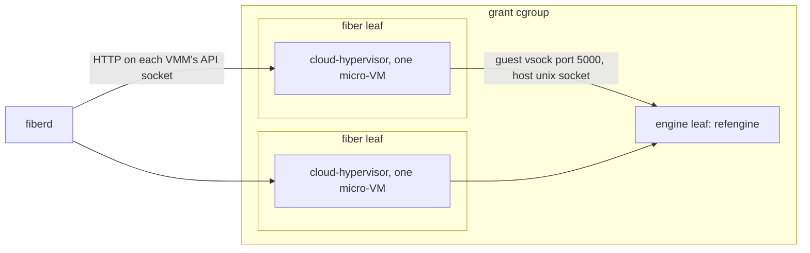
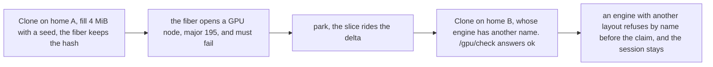
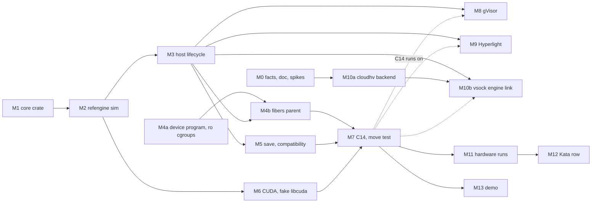

# GPU PoC: one host engine on every backend, a cross-GPU move, and a micro-VM backend

The design for the `gpu-poc` branch, 2026-10-22. It builds on the [GPU proposal](gpu.md) (decisions D1 to D6) and changes it where a review against the code found gaps. It is built and on main. Its done criteria hold except the A to B move, which needs a second GPU model ([#61](https://github.com/helayoty/fiberd/issues/61)). Claims marked **verify** were not rechecked after the build. No speed here was measured.

## The question

The PoC answers one question.

> Can a fiber under proc, runc, gVisor, Hyperlight or a micro-VM, and under the Kata shim, use one host GPU engine, park its GPU session state, and resume against another compatible engine on another GPU model, with no GPU device granted to the fiber?

Three pieces answer it.

- **The host engine.** `refengine`, a Rust process fiberd starts per device grant, replaces the simulated engine inside the zygote.
- **Part 1.** A test that moves a parked session, slice bytes included, between two MIG instances of the A100 on VM A, then to VM B with another GPU model.
- **Part 2.** A Cloud Hypervisor backend, so a fiber can be a real micro-VM that reaches the host engine over vsock.

C14, the answer check, is the exit criterion. It runs the whole question on every backend and fails if any step fails.

**Decided by the user on 2026-10-22.**

- Tests in the PoC are only C14 and the move test. The rest come before the merge to main ("Tests in the PoC").
- This file is the PoC's only doc change.
- The engine is `refengine` in Rust now, per D6.
- One long-lived `gpu-poc` branch, one commit per milestone. It merges to main after the deferred tests.
- The A100 on VM A is split into two MIG instances, so VM A runs two homes.
- The Kata row runs kind on VM A, pointed at a VM A home, and is built last.
- Cloud Hypervisor is the micro-VM.

## Where fiberd stands

On main at `2ad188a` the answer is no. Only proc and runc share an engine, and it is a simulated device inside the zygote (`sdk/c/template/refzygote.c:212-493`).

| Part of the question | proc | runc | gVisor | Hyperlight | micro-VM | Kata shim |
| --- | --- | --- | --- | --- | --- | --- |
| One shared engine | Partly. A thread in the zygote, simulated (`refzygote --device-mb`) | Partly. The same engine in the container's init (`TestDeviceOnRunc`) | No. Device grants are refused, and a gVisor fiber has no zygote | No. The helper registers no host functions | No backend | Whatever the backend under it does |
| Park keeps GPU state | No. Park evicts before the dump (`pkg/runtime/host/host_linux.go:1627`) | No | No | No | No | No |
| Resume on a compatible engine | Partly. A session moves and reserves again. `OffersDevice` ignores the class (`host_linux.go:379`) | Partly, same | No | No | No | As the backend |
| No device granted | True only because there is no GPU. Nothing keeps a proc fiber off `/dev/nvidia*` | Same | n/a | n/a | n/a | n/a |
| A real GPU | No | No | No | No | No | No |

The Kata shim (`examples/kata`) is a consumer. It clones fibers on whatever backend the home runs and boots no VM. That is why the question needs a micro-VM backend of its own.

## The host engine

The engine is the proposal's D2 and D6. This section records what the PoC builds and where it departs from the proposal.

**The binary.** `refengine` is a Rust std binary in `sdk/c/template/engine`. It uses the zygote library's core crate for the line tokenizer, the seccomp builder and bounded `/proc` parsing. The core crate gains an additive `std` feature, since it builds as both `staticlib` and `rlib` (`core/Cargo.toml:14`). Under `std` the panic handler and personality stub (`core/src/lib.rs:69-90`) are left out. Its tokenizer becomes `pub`, and `seccomp::Program` gains an `Engine` variant.

**Start-up.** fiberd starts the engine when it warms a grant with a device budget and the home names an engine through `-engine`. It runs in `<grant>/engine` as its own unprivileged uid, under `no_new_privs`, with the device in `FIBERD_DEVICES`. The engine opens the device, allocates its pool, binds its socket and installs its seccomp program. Then it writes these lines on fd 3, and fiberd admits the grant only after both the engine and the zygote said READY.

| Line, engine to fiberd | When |
| --- | --- |
| `ENGINE <class> <capacity> <version> <layout>` | Once, first. Class is `sim` or `gpu`. The reference layout is `raw256` |
| `GPU <name> <compute capability> <driver>` | Once, informational. `sim` engines report a made-up name |
| `READY` | Once, after the seccomp program is in place |
| `DEVICE <fence> <bytes> 0` and `DEVICE - <used> <capacity>` | After every change to a slice |
| `HELD`, `SAVED`, `RESTORED`, `ERROR` | Replies to `HOLD`, `SAVE` and `RESTORE` (Part 1) |

**The template ABI stays at 11.** No `ENGINEPATH` line and no ABI 12 in the PoC. fiberd passes the socket path in `FIBERD_ENGINE_PATH`. `refzygote.c` reads it and calls `fz_set_engine`, and the core already sets each fiber's `FIBERD_ENGINE` from that (`core/src/zygote.rs:882-896`). The ABI change waits until after the PoC.

**Whose fence.** The engine learns which fiber calls from the kernel, never from the line, and never from the leaf's name. Name parsing breaks for pooled fibers in `pool/p-N` (`pool_linux.go:70`), for Hyperlight, and under the `fibers/` parent. So fiberd tells the engine.

| Line, fiberd to engine | When | What the engine does |
| --- | --- | --- |
| `LEAF <fence> <cgroup path>` | At every birth and every resume, before the fiber runs | Maps that cgroup to the fence |
| `UNLEAF <fence>` | When the fiber ends or parks | Forgets the mapping |
| `RELAY <cgroup path>` | Once, for the Hyperlight helper's leaf | Lets a peer in that cgroup name the fence in its line, since the helper vouches for its guests |
| `EVICT <fence>` | When a fiber with a device budget ends | Drops the slice and reports it |

On accept the engine takes the peer's pidfd (`SO_PEERPIDFD`), reads its `/proc/<pid>/cgroup`, and looks that path up in its LEAF table. A peer in no known leaf gets `err fence`, and so does a line that names another fence. The pidfd is checked again after the read, so a recycled pid is refused.

**The socket.** Today the simulated engine binds `engine.sock` in `<RunDir>/<grant>`, which a uid-0 proc fiber owns and could swap for a fake. The socket moves into a directory owned by the engine's uid, under the grant, so a fiber without capabilities cannot rename, remove or replace anything in it. runc fibers get that directory as a read-only bind, and gVisor gets it as its own read-only mount in the warm spec. A uid-0 fiber still owns `<RunDir>/<grant>` itself, and a rename of the engine directory within it needs only write access to the parent. M3 closes that by anchoring the directory where no fiber can write (**verify** in M3).

**Seccomp.** The engine's program is the runc program's list with no `clone3` gate and with `execve` refused, as the proposal's "Seccomp" section says. It goes on every thread after the driver is up and before the first accept.

**Engine death.** As in the proposal. A sticky CUDA error ends the engine, fiberd zeroes the accounting, refuses Clones with a retryable error, and restarts it with backoff. The new engine must declare the same class.

## Part 1. The cross-GPU move

### What it proves

A fiber's CPU state and its GPU slice leave one home together and arrive intact on another, whose GPU may be another model. The receiving engine is chosen by what it declares (class and layout), never by which GPU it drives.

Moves go through a shared delta registry, as `hack/test/mobility.sh` does today. A park publishes the delta, and a Clone of the same session on the other home claims it. There is no export or import step and no copy through the Mac.

The expected hash lives in the fiber's own memory, not in the test. So a pass means the restored CPU state and the restored slice belong to the same session.

### Engine requests

Two requests change against the proposal's table. One request per connection and one reply, at most 256 bytes, as today.

| Request | Reply | Change |
| --- | --- | --- |
| `fill <fence> <seed>` | `ok <hash>`, `err fence`, `err none` | A pattern instead of one byte. Each 8-byte word is xorshift64 of the seed and its offset, so a shifted, truncated or zeroed restore cannot pass |
| `sum <fence>` | `ok <hash>`, `err fence`, `err none` | FNV-1a 64 of the slice, copied back to the host |

`reserve`, `release` and `stat` stay as the proposal has them.

### Save and restore lines

Three more lines on fd 3, all from fiberd. fiberd sends descriptors to the engine and never takes one back. The engine never sends descriptors.

| Line | Reply | What happens |
| --- | --- | --- |
| `HOLD <fence>` | `HELD <fence>` | The engine finishes any request in flight for that fence and answers new ones `err held`. The slice can no longer change |
| `SAVE <fence>`, one descriptor attached | `SAVED <fence> <bytes> <hash>` or `ERROR <fence> <reason>` | The engine copies the slice to the host and writes it to the descriptor. fiberd opened the file, so the engine needs no write access to the park directory. The slice stays on the device while it is held |
| `UNHOLD <fence>` | none | Lifts the hold and keeps the slice, so a fiber whose park failed runs on with it |
| `RESTORE <fence>`, one descriptor attached | `RESTORED <fence> <bytes>` or `ERROR <fence> <reason>` | The engine checks the header, reserves a slice under the resume's new fence, copies the bytes in and reports it. A fence that is held, mapped or already has a slice is refused as `busy` |

### Park and resume order

The park no longer evicts before the dump.

- The quota check (`host_linux.go:1585-1600`) adds the slice's bytes.
- The fiber's exit path evicts every slice (`host_linux.go:1197`). It skips a held fence, so the slice survives until the file is in place.
- If `SAVE` or `be.Park` fails, the park fails as a failed CRIU dump does today. fiberd drops the staging file and sends `UNHOLD`, and the fiber keeps running with its slice.

**At resume** the order is `RESTORE` under the new fence, then `LEAF`, then `be.Resume`. The fiber never runs without its slice. If the resume fails, fiberd evicts the new fence.

**The slice file.** `device.slice` in the delta directory, next to `workspace.tar` (`pkg/runtime/host/workspace_linux.go:22`). One header line, `fiberd-slice 1 <class> <layout> <bytes> <hash>`, then the raw bytes. It rides seal, signature, quota, publish and claim with the rest of the directory.

### Compatibility before the claim

`ClaimDelta` deletes the registry tag before the resume (`mobility_linux.go:197`). A check after the claim would lose the session on a refusal. So the park publishes the engine's facts in the delta's annotations (`mobility_linux.go:86`, `pkg/artifact/parity.go`), and the claiming home compares them before it claims. A refusal leaves the session in the registry, so it can resume on a home that fits.

| Fact | Published at park | Compared before the claim |
| --- | --- | --- |
| Class (`sim`, `gpu`) | Yes | Yes. Refused by name when it differs |
| Layout (`raw256` for the reference engine) | Yes | Yes. A model engine would name its model hash, KV dtype and block size here |
| Engine version | Yes | No. Logged only |
| GPU name, compute capability, driver | Yes | **No, on purpose.** The test exists to show these may differ |

### The move test

`tests/integration/gpu/move_linux_test.go`, build tags `linux && integration && gpu`. One test, `TestMoveAcrossGPUs`, whose phase comes from `FIBERD_GPU_MOVE`. The registry address comes from `FIBERD_GPU_MOVE_REGISTRY`.

| Phase | Where | What it does |
| --- | --- | --- |
| `park` | One home | Clone, `POST /gpu/fill?seed=…`, park and publish. Logs the GPU facts, slice bytes and SAVE time |
| `resume` | Another home | Clone the same session, which claims and resumes, then `GET /gpu/check`. Runs the refusal cases. Logs the GPU facts and RESTORE time |
| `local` | One host | Both phases with two homes in one process |

`refzygote --http` gains two routes. `POST /gpu/fill?seed=S&bytes=N` reserves, fills and keeps the returned hash in the fiber's memory. `GET /gpu/check` asks for the hash and answers `ok` or `mismatch <kept> <now>`.

Both phases mint grants from one issuer key with a fixed uid, and every home shares the delta key and seal key, as `mobility.sh` does. So the session verifies and opens on every home.

| Check on the resuming home | Pass condition |
| --- | --- |
| It is a resume | `ActResume`, and the fiber's counter carries the parked value |
| The slice survived | `/gpu/check` answers `ok` |
| It was another GPU | The logged GPU names, MIG UUIDs or compute capabilities differ |
| Wrong layout | An engine declaring another layout refuses before the claim, naming both layouts, and the session stays in the registry |
| Pool too small | An engine whose pool is smaller than the slice answers `ERROR … capacity`, and the session is not lost (**verify** in M5 how a failed RESTORE after the claim keeps it) |
| Tampered slice | A flipped byte in `device.slice` fails the seal check before the engine sees it |

`hack/gpu/move.sh` drives the runs from the Mac, over ssh to each VM, and each phase runs in the dev container with `--gpus all`. The user runs it and shares the output.

### The registry

A `registry:2` container on VM A's private IP. VM B must reach it, so both VMs share a virtual network or a peering with a rule for the port. The fallback is a registry on the Mac, reached from each VM through `ssh -R`.

Both homes on VM A use the same template cache path, since proc parity compares templates.

### The hardware runs

1. C14 on both VM A homes.
2. The A1 to A2 move. Same GPU model, two MIG UUIDs. A failure here points at the move, not the GPU.
3. A proc move from A to B and back with no device budget. It checks CRIU across the two CPUs before any GPU is involved.
4. The GPU move from A to B.

### The two VMs

`hack/gpu/facts.sh` prints each VM's facts in a stable form, and the user diffs them.

| Need | VM A | VM B |
| --- | --- | --- |
| GPU | A100, split into two MIG instances. Each home's engine selects one MIG UUID (M6) | Another model. An NVIDIA T4 (`Standard_NC4as_T4_v3`) is the cheapest. Avoid the A10 `NVads` sizes, which share the GPU through vGPU |
| CPU | AMD EPYC | AMD EPYC, which `NCasT4_v3` has. CRIU's CPU check compares the hosts (**verify** with facts.sh and run 3) |
| Kernel | `6.17.0-1022-azure`, CI's series | The same. A proc park's parity covers the kernel |
| Driver | 590.x | The same branch (**verify** that 590 still supports Turing) |
| Software | Ubuntu 24.04, Docker, the NVIDIA Container Toolkit, the dev image | The same |
| `/dev/kvm` | Likely absent on Azure GPU sizes (**verify** with facts.sh) | Not needed |

### Open questions

- Whether CRIU restores VM A's checkpoint on VM B's CPU. Run 3 answers it before the GPU move.
- SAVE and RESTORE time for a large slice. They are logged, not claimed.
- Whether the slice should be compressed in the delta. Not in the PoC.

## Part 2. A Cloud Hypervisor backend

### Why a backend of its own

Kata Containers boots a micro-VM per Pod, but it cannot snapshot and restore one, so a Kata sandbox could never park. The PoC drives a hypervisor Kata can run on, as a fiberd backend named `cloudhv`.

| Option | Outcome | Why |
| --- | --- | --- |
| Cloud Hypervisor | Chosen by the user | A Kata hypervisor, in Rust, with snapshot and restore, virtio-vsock and its own seccomp filter |
| Firecracker | Not chosen | The repo already drives it in `bench/compare/adapters/firecracker`. It stays the comparator |
| Kata Containers as the backend | Rejected | No sandbox snapshot, so no park |

The backend's name is a parity fact, like `proc` and `gvisor`.

### The shape

One `cloud-hypervisor` process per fiber, started inside the fiber's leaf, so leaf counters, budget kills and `cgroup.kill` work as for proc. fiberd drives each one over its API socket with plain HTTP, as the Firecracker comparator does.

| Piece | Where | What it is |
| --- | --- | --- |
| Backend | `pkg/backend/cloudhv` | Warm, Clone, Park, Resume and Kill over the API socket, shaped like the Hyperlight backend |
| Guest kernel and rootfs | `hack/cloudhv/` | A small kernel with virtio-vsock and virtio-blk, and a read-only rootfs with the template and a guest agent. Built by a script, pinned by hash |
| Guest agent | `hack/cloudhv/agent` | The guest's init. Takes the incarnation, serves the fiber's endpoint over vsock, and carries engine requests |
| Fake VMM | `hack/cloudhv/fakevmm` | A stand-in for the API subset, so CI runs the backend without KVM, as `hack/hyperlight/fakehelper` does |

### The pinned release

The spikes and the backend pin Cloud Hypervisor `v54.0`. The guest kernel is the one `v53.0`'s own tests use. `hack/cloudhv/spike/README.md` lists what was checked in the source and docs. These hold in `v54.0`.

- The REST API has `vm.create`, `vm.boot`, `vm.pause`, `vm.resume`, `vm.snapshot`, `vm.restore`, `vm.info` and `vmm.shutdown`.
- `--restore source_url=file://<dir>` brings a VM back paused. A restore picks `memory_restore_mode=copy` (the default), `ondemand` (userfaultfd) or `copyonwrite` (a private mapping of the snapshot's memory).
- The API table lists "created but not booted" for `vm.restore`, while the snapshot guide restores into a fresh VMM. The backend uses the `--restore` flag, which avoids the question.
- Seccomp is on by default. Landlock exists and is off unless asked.

### The lifecycle

| fiberd | Cloud Hypervisor | Notes |
| --- | --- | --- |
| Warm | Start a VMM in a warm leaf, `vm.create` with the kernel, the read-only rootfs, vsock and the memory, then `vm.boot`. Wait for the agent's ready line, then `vm.pause`, `vm.snapshot` to `<state>/cloudhv/<grant>/warm/`, and end the VMM | The warm snapshot is the template |
| Clone | Start a VMM in the fiber's leaf with `--restore`, then `vm.resume`. Send the incarnation on vsock and wait for `served` | Each VMM gets its own mount namespace, so the vsock and serial paths in the snapshot's `config.json` resolve to its own files |
| Park | Ask the agent to stop serving, `vm.pause`, `vm.snapshot` to the park directory, end the VMM | Inside the host's park order (Part 1) |
| Resume | Start a VMM in the new leaf with `--restore` from the park directory, `vm.resume`, send the new incarnation | The host sends `RESTORE` first |
| Kill | `vmm.shutdown`, then the host kills the leaf | |

### Reaching the engine

Checked in `v53.0` (`docs/vsock.md` and the vsock muxer). The VM's vsock device is backed by a unix socket on the host. When the guest connects to CID 2 port N, the VMM process connects to the host unix socket `<vsock socket>_N`.

- fiberd places `<vsock socket>_5000` as a link to the grant's engine socket. Port 5000 is the engine in every VM.
- The engine's peer on that connection is the `cloud-hypervisor` process, in the fiber's leaf. fiberd sent `LEAF` for that leaf, so the peer check works unchanged and no relay is needed (S2 checks it).
- The guest agent exposes the engine as `FIBERD_ENGINE=vsock://2:5000` and forwards the template's lines. A guest cannot name another fiber, since the engine checks the fence against the peer.
- Each request is one connection, so a park never carries an open engine connection. Whether one would survive is S3, and the design never depends on it.

### The fiber's endpoint

The fiber serves its endpoint on vsock port 1024 inside the VM. fiberd connects to `<vsock socket>`, writes `CONNECT 1024` and reads `OK <port>`, the hybrid handshake checked in `v53.0`. The host runtime serves the fiber's unix endpoint by splicing to that connection. No tap device or network namespace per fiber is needed.

### Identity and seed

Every Clone and Resume sends the agent one line, `INCARNATE <generation> <fence> <seed-hex>`, before it binds the endpoint. It is the same contract as Hyperlight's `Incarnate`. The agent reseeds the guest kernel's random pool (`RNDADDENTROPY`) and its own generator before anything else runs. A restored guest that never answers is ended.

### Memory and W

fiberd's value is many cheap copies of one warm template. If each Clone copied the whole warm memory, a micro-VM fiber would cost its full memory size, not its dirty pages. So a Clone restores copy-on-write.

| Way to restore | Cost per Clone | Status in `v54.0` |
| --- | --- | --- |
| `memory_restore_mode=copyonwrite` | Only the pages the fiber writes. The rest is the warm snapshot's page cache | New in `v54.0`. The backend's default for a Clone |
| `memory_restore_mode=copy` | The whole guest, in private memory | The VMM's default. Every Resume uses it |
| `memory_restore_mode=ondemand` | The pages touched, still private | Present. Needs userfaultfd and refuses `prefault=on` |
| A file-backed memory zone. The warm VM maps it shared, so the snapshot skips it. Each Clone's `config.json` maps it private | Only the pages the fiber dirties, shared page cache for the rest | Not used by the backend. S1 still tries it |

With copy-on-write, a fiber's W counts the pages it writes, as for proc. Its fixed footprint is the VMM alone. Its leaf's ceiling still leaves room for the whole guest, since a Resume copies its park in whole. When a Clone's restore falls back to copy, fiberd writes a line to the grant's log, and that fiber's W counts the whole guest.

### Isolation

| Layer | What does it |
| --- | --- |
| The guest kernel | The fiber's code runs on its own kernel behind KVM. The backend implements `Isolator`, so it can serve untrusted grants |
| The VMM's system calls | Cloud Hypervisor's own seccomp filter, on by default. Landlock on the files it may open |
| The VMM's uid | A per-grant unprivileged uid with access to `/dev/kvm` alone, under `no_new_privs`, in a mount namespace that shows only the kernel, the rootfs, the snapshot directory and its sockets |
| The GPU | No VFIO device and no `/dev/nvidia*`. The device program on `fibers/` covers the VMM's leaf too |
| The engine socket | The engine's directory is bound read-only into the VMM's mount namespace |

### Parity

`Platform()` reports what a VM snapshot depends on. That is the Cloud Hypervisor release, the guest kernel's hash, the rootfs hash, and the host CPU facts S5 finds to matter. A snapshot restores only on a home with the same facts.

### Spikes before code

Scripts in `hack/cloudhv/spike/`, run on a KVM host by the user or by the `cloudhv-spike` workflow on GitHub runners.

| # | Question | How |
| --- | --- | --- |
| S1 | Can a restore share the warm memory copy-on-write, and what does a Clone cost in time and W | 64 restores of one snapshot alive at once, per restore mode. Each VMM's Private_Dirty, Rss and Pss, and the time to `vm.resume` |
| S2 | Does the engine's peer check name the VMM's leaf | A VMM in a known leaf, a guest that connects to port 5000, a listener that prints its peer's pid and `/proc/<pid>/cgroup`. Booted and restored |
| S3 | What happens to an open vsock connection across a snapshot and a restore | One kept connection, snapshot, resume in place, end the VMM, restore, try both ends |
| S4 | Time from VMM start to the guest's `served` line | 20 restores per mode, min, median and max. Sets `DefaultDeadlines` |
| S5 | Which CPU facts a snapshot depends on | Snapshot on one host, restore on another, compare their CPU facts |

The Firecracker comparison S1 asks for comes from `bench-compare.yml` on the same runner type.

### Open questions

- Whether the guest agent is C on the core crate or a Rust std binary. It parses host input only, so either fits.
- Whether one VMM per fiber is affordable in host memory. S1 shows the VMM's own share.
- Workspaces. A virtio-blk image per fiber would work. Not in the PoC.
- Handoff endpoints pass a TCP socket over `SCM_RIGHTS`, which cannot cross into a VM. A `cloudhv` home refuses handoff grants by name.
- Whether the gVisor backend's way of reaching its sandboxes fits the endpoint splice (**verify** in M10).

## The answer check, C14

`tests/e2e/conform/gpu.go`, enabled by a `-gpu` flag. It runs on one backend at a time, with the `sim` engine in CI and the real one on VM A.

On proc and runc the device program refuses the GPU node. In gVisor, Hyperlight and a micro-VM no such node exists. The flow is the same on every backend, so one check answers the question for each row.

## Milestones

One commit per milestone on `gpu-poc`. CI runs on every push.

| M | Delivers | Main files | Parallel with |
| --- | --- | --- | --- |
| **M0** Facts and doc | This doc. `hack/gpu/facts.sh` and the spikes in `hack/cloudhv/spike/`, all for the user to run. The user also slices MIG on VM A and provisions VM B | docs, `hack/`, `.github/workflows/cloudhv-spike.yml` | All |
| **M1** Core as a crate | The `pub` tokenizer, the `std` feature, `seccomp::Program::Engine` | `core/{Cargo.toml,src/lib.rs,line.rs,seccomp.rs}` | M0, M4a, M10a |
| **M2** refengine, simulated | `sdk/c/template/engine`. The pool, the request protocol, the fd 3 lines, the control lines, the peer check, and its seccomp filter | `engine/src/{main,peer,proto,ctl}.rs` | M4a, M10a |
| **M3** Host lifecycle | `pkg/runtime/host/engine_linux.go`. Start the engine in `<grant>/engine` as its own uid, wait for `ENGINE` and `READY` before admission, send `LEAF` at births. `OffersDevice`, the sampler, `evictDevice` and `Stats` read the engine. The class rule in `core.go`, the `-engine` flag. The in-zygote engine and `DeviceReporter` go, and their tests are adapted or removed | host, fiberd, core, refzygote, proc, `stub.sh` | M4a, M6, M10a |
| **M4** Fiber guard | a. The device program (`pkg/sys/cgroup/devprog_linux.go`) and cgroup mounts read-only by file system type (`core/src/mounts.rs`). b. The `<grant>/fibers/` parent and its attach, after M3 | sys, core, host | a with M1 to M3 |
| **M5** Save and compatibility | `engine/src/slice.rs`, `HOLD`, `SAVE`, `RESTORE`. The park and resume order. Annotations checked before the claim. The `/gpu/fill` and `/gpu/check` routes | engine, host, `mobility_linux.go`, `parity.go`, refzygote | M6, M8, M9 |
| **M6** CUDA over a fake libcuda | `engine/src/cuda.rs` (dlopen, primary context, pool, seeded fill, hashing sum, sticky-error exit, MIG UUID selection). `sdk/c/template/fakecuda/fakecuda.c` with `FAKECUDA_NAME` | engine, fakecuda | M5 |
| **M7** C14 and the move test | `tests/e2e/conform/gpu.go` with `-gpu`, on proc and runc. `tests/integration/gpu/move_linux_test.go` with `park`, `resume` and `local`. `hack/gpu/move.sh` and Makefile targets | tests, hack | M8 to M10 |
| **M8** gVisor | The engine directory as a read-only mount, `FIBERD_ENGINE` in the spec, the park waiting for in-flight requests, device grants allowed. C14 on gVisor | `pkg/backend/gvisor`, refzygote | M9, M10 |
| **M9** Hyperlight | An `engine(line)` host function in the helper and the fake helper, `RELAY`, guest `GpuFill` and `GpuCheck`. C14 on Hyperlight | `hack/hyperlight/*`, `pkg/backend/hyperlight` | M8, M10 |
| **M10** Cloud Hypervisor | a. After S1 to S5, `pkg/backend/cloudhv`, `hack/cloudhv/{build.sh,agent,fakevmm}`, `-runtime cloudhv`, a mount namespace per VMM, and the `conform-cloudhv` and `conform-cloudhv-fake` CI jobs. b. The vsock engine link, after M3. C14 on it | `pkg/backend/cloudhv`, `hack/cloudhv`, CI | All |
| **M11** Hardware | The user runs C14 on VM A's MIG homes, the A1 to A2 move, the GPU-free proc move A to B and back, then the GPU move A to B | none | M12, M13 |
| **M12** Kata row | A mode in `examples/kata/kind/run.sh` that points `io.fiberd/home` at a VM A home. kind runs on VM A | examples/kata | after M11 |
| **M13** Demo | A live page in fiberd-demo, and a recording replayed on Pages | fiberd-demo | from M7, on the `sim` engine |

**Done** means four things hold.

- C14 is green in CI on proc, runc, gVisor, Hyperlight and Cloud Hypervisor.
- The user's runs show `/gpu/check` answering `ok` after the A1 to A2 move and after the A to B move, with different GPUs logged.
- The Kata shim run passes on a VM A home.
- The demo plays the recorded run on Pages.

## Tests in the PoC

The PoC adds two tests and no others.

- **C14**, on every backend, with the `sim` engine in CI.
- **The move test**, with its `park`, `resume` and `local` phases. The `local` phase also runs over the fake libcuda, with `FAKECUDA_NAME` giving each home's engine another device name.

Existing tests stay green. Tests of code the PoC removes, such as the in-zygote engine, are adapted or removed with it.

The deferred tests come before the merge to main. That means table-driven unit tests for each milestone, a regression test proven to fail on the old code for each gap closed, and fuzz targets for the new parsers (the engine's lines and its `/proc/<pid>/cgroup` read). The docs pass and the bench A/B runs for M3 and M4 come then too.

## Out of scope

- Kata Containers itself as a backend, since it cannot park.
- A GPU inside any guest, through VFIO or nvproxy. The GPU stays on the host.
- A model-serving engine. The reference engine's only layout is `raw256`.
- MPS, and more than one GPU or MIG instance per engine.
- The `ENGINEPATH` setup line and ABI 12.
- Workspaces and handoff endpoints on `cloudhv`.
- Compressing the slice in the delta.
- Speed claims. Every time here is logged, not claimed, until an interleaved A/B run.
- arm64 for `cloudhv`. CI's KVM runners are x86_64.
