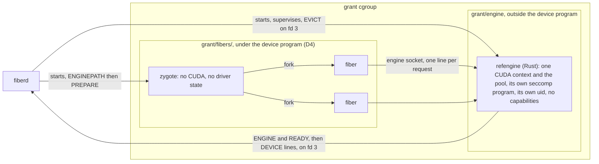
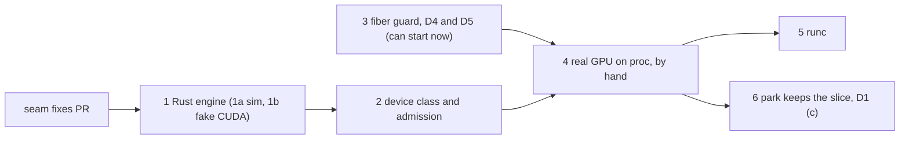

# GPU fibers on proc and runc

Status: built for [#4](https://github.com/helayoty/fiberd/issues/4) through the [GPU PoC](gpu-poc.md), which changed parts of this design. The PoC also does two things this cut left out. A park keeps the slice, and gVisor, Hyperlight and a micro-VM backend share the engine too. The text below is the design as proposed.

## Summary

Today a device [engine](../glossary.md#engine) is a thread inside the [zygote](../glossary.md#zygote), and the reference one only simulates a device. This proposal makes a real GPU usable by [fibers](../glossary.md#fiber) on the proc and runc [backends](../glossary.md#backend).

A GPU fiber here is an ordinary forked fiber that holds no device state of its own. [fiberd](../glossary.md#fiberd) starts one engine process per [grant](../glossary.md#grant) with a [device budget](../glossary.md#device-budget), beside the zygote. The engine holds the grant's one GPU, one CUDA context and a pool of device memory. A fiber asks it for a slice of that pool over a unix socket. The engine reports every slice to fiberd, which prices it and enforces the budget, as it does today.

The zygote and its fibers never open the GPU. A [cgroup](../glossary.md#cgroup) device program keeps them off it, so a fork carries no driver state and a [park](../glossary.md#park) stays a plain [CRIU](../glossary.md#criu) dump.

This proposal assumes main already sends EVICT whenever a fiber with a device budget ends, checks the [fence](../glossary.md#fence) of every engine request, and passes devices to runc zygotes. Those fixes land separately, before this work.

## Goals and non-goals

Goals.

- Many fibers of one grant share one GPU through one CUDA context.
- A device class always comes from a binary the [home](../glossary.md#home) named, never from [template](../glossary.md#template) code.
- A grant asking for class `gpu` is refused loudly by a home whose engine offers another class.
- No fiber can reach the GPU, another fiber's slice, or another fiber's budget.
- A GPU fault ends the engine, never the zygote or the grant's running fibers.
- The whole engine path runs in ordinary CI through a fake driver. Only a few checks need a real GPU.

Non-goals, for this cut.

- gVisor, which needs nvproxy, and Hyperlight, which has no device path. Both keep refusing device grants at admission.
- MIG management and MPS. A MIG instance made by hand is just the one device its engine drives.
- More than one device per engine.
- Fibers that own a CUDA context.
- Device state kept across a park. A park drops the slice for now (D1).
- Compute kernels in the reference engine, and a client library for the engine protocol.

## The shape

| Piece | Owner | What changes |
| --- | --- | --- |
| `refengine` | fiberd, one per grant with a device budget | New, in Rust (D6). `--sim-mb` is today's simulated device moved out of the zygote. `--cuda-pool-mb` drives a real GPU |
| Engine lifecycle | `pkg/runtime/host` | New. Start, the fd 3 channel, DEVICE lines, EVICT, supervision and restart, one path for proc and runc |
| Zygote | the template | Hosts no engine. Learns the socket path from one new setup line, `ENGINEPATH` |
| Device program | `pkg/sys/cgroup`, attached by the host | New, on `<grant>/fibers/` (D4) |
| Admission | `pkg/core` | Checks the class the engine declared |

Today the zygote, the probe and each fiber leaf sit directly under the grant's cgroup ([resources.md](../design/resources.md)). They move under a new `<grant>/fibers/` parent, and the engine gets `<grant>/engine` beside it. The engine's host memory and tasks count against the grant.

## Decisions

All six are decided. Rejected options stay, with why they lost.

| # | Question | Decided |
| --- | --- | --- |
| D1 | What a park does to a fiber's slice | Evict it now. Later the engine saves the slice's bytes into the [delta](../glossary.md#delta) |
| D2 | Where the CUDA context lives | A sibling engine process beside the zygote |
| D3 | How GPU code runs | By hand on a maintainer's GPU VM, with a fake driver in CI |
| D4 | How fibers are kept off `/dev/nvidia*` | One cgroup device program on `<grant>/fibers/` |
| D5 | How a fiber is kept in its own cgroup leaf | proc makes every cgroup mount read-only. runc relies on having no cgroup mount, pinned by a test |
| D6 | The engine's language | Rust, on the zygote library's core crate |

### D1. Park

| Option | Outcome | Why |
| --- | --- | --- |
| (a) Evict. The slice is dropped and the fiber reserves again on resume | Chosen, now | It is today's contract. A park costs one EVICT line, the delta does not grow, and a resume works on any home and any GPU |
| (c) The engine copies the slice's bytes into the delta and back on resume | Chosen, as stage 6 | It keeps the bytes and fits the engine model. It costs a device-to-host copy per park, unmeasured, and delta space counted against the delta quota |
| (b) `cuda-checkpoint` with CRIU's CUDA plugin | Rejected | It checkpoints a whole process with every context it holds. Run on the engine it would pause every fiber's slice at once. It keeps one fiber's slice only if that fiber owns a context, which D2 rules out. It also needs a plugin build, GPU [parity](../glossary.md#parity) facts and a second GPU host to prove a move |

CRIU loads every plugin in its plugin directory. fiberd should run it with a plugin directory that holds no CUDA plugin, so a host that installed one for other reasons does not change what a park does.

### D2. Where the CUDA context lives

| Option | Outcome | Why |
| --- | --- | --- |
| A sibling engine process fiberd starts beside the zygote | Chosen, for security | The zygote's seccomp program, which every fiber inherits, is not widened for the driver. No fiber forks from a process holding driver threads, mappings or descriptors. A driver fault ends the engine, not the zygote and its fibers. The class comes from a binary the home named |
| The context in the zygote, on an engine thread | Rejected | It matches the issue's wording and needs no extra process. But the fiber filter would have to be widened for the driver, and every fiber would fork from a process holding driver state, kept out only by the scrub and the driver's fork handling. A sticky CUDA error would end the zygote and every running fiber |

The cost is one more process per device grant, and one socket round trip per request, unmeasured. The engine declares its class before admission, which also closes today's race between admission and the engine's first report.

### D3. How GPU code runs

| Option | Outcome | Why |
| --- | --- | --- |
| By hand on a maintainer's GPU VM | Chosen | No repo move, no runner a pull request can reach, no per-minute billing. A fake driver runs the whole engine path in ordinary CI |
| A GitHub GPU larger runner | Rejected | Larger runners need an organization plan. The repo would have to move, with GPU billing per minute on top |
| A self-hosted runner on a GPU VM | Rejected | A persistent runner to keep up, and GitHub advises against self-hosted runners on public repos, since a pull request can run code on them |

The VM has one NVIDIA A100-class data-center GPU and runs the same kernel series as CI, 6.17. The maintainer runs the GPU targets in the dev container and shares the output. Regressions can land between manual runs, and the fake-driver runs in CI keep that gap small.

### D4. Keeping fibers off `/dev/nvidia*`

| Option | Outcome | Why |
| --- | --- | --- |
| One cgroup v2 device program on a new `<grant>/fibers/` parent | Chosen | Attached once, before any fiber exists. It covers born and resumed fibers with no step per birth. The zygote and the probe move under the same parent, so template code is off the GPU too |
| One program per fiber leaf | Rejected | It attaches on every [clone](../glossary.md#clone) and every resume, each a chance to fail or race the fiber's first instruction, and each attach takes `cgroup_mutex` on the birth path |

### D5. Keeping a fiber in its own cgroup leaf

The engine knows a fiber by its cgroup leaf ("Whose fence" below). A fiber that can write another leaf's `cgroup.procs` can move into it and spend that fiber's budget. It could also move into the engine's leaf, out from under the device program.

On main a proc fiber already cannot write cgroup files under `/sys`, since the zygote makes every mount under `/sys` read-only and every proc fiber drops its capabilities ([zygote.md](../design/zygote.md#how-it-works)). The gap is that the check matches mount points under `/sys`, not the file system type. A cgroup2 mount anywhere else in fiberd's mount namespace stays writable in every proc fiber, and a uid-0 fiber owns those files. On runc the host hands the grant's mapped root each leaf's `cgroup.procs`, and the missing cgroup mount in the bundle is all that stops a runc fiber.

| Option | Outcome | Why |
| --- | --- | --- |
| (i) Make every `cgroup` and `cgroup2` mount read-only in the zygote's namespace, by file system type | Chosen, for proc | The same pass over mountinfo as the `/sys` one, once per grant, nothing per birth. It changes flags only, so CRIU dumps and restores the same tree. Reads still work, which runtimes that size themselves from `memory.max` need |
| (ii) A cgroup namespace rooted at the fiber's leaf | Rejected | The fiber filter refuses `unshare(CLONE_NEWCGROUP)`. The kernel refuses a move across the namespace root only under `nsdelegate`, a host-wide option fiberd does not control. CRIU's handling of it is unproven |
| (iii) Hide or unmount the cgroup trees | Rejected | It breaks reads of a fiber's own limits, changes the tree CRIU dumps, and needs a rule for which trees to keep |
| (iv-a) On runc, stop handing `cgroup.procs` to the mapped root | Rejected | A runc birth moves the child with `CLONE_INTO_CGROUP`, which needs write access to the leaf's and the common parent's `cgroup.procs` |
| (iv-b) On runc, keep the hand-over and rely on the missing mount | Chosen, for runc | The bundle has no cgroup mount, `/sys` is a read-only bind of the host's sysfs alone, and the runc program refuses the mount family ([seccomp.md](../design/seccomp.md#how-it-works)). A test pins that no cgroup file system appears in a runc fiber's mountinfo |

### D6. The engine's language

| Option | Outcome | Why |
| --- | --- | --- |
| Rust. A std binary, `refengine`, in its own crate under `sdk/c/template/engine`, depending on the no_std core crate | Chosen | The engine is a trusted process whose job is parsing lines from [tenant](../glossary.md#tenant) fibers, so memory safety matters most there. The core already holds a fuzzed line tokenizer, the compile-time seccomp builder and bounded `/proc` parsing. The engine calls them as a crate, so no engine-only call enters the template ABI |
| C, carrying today's simulated engine over from `refzygote.c` | Rejected | It keeps a `sscanf` parser of hostile input in C. And a C engine reaches the core's seccomp builder only through exported C calls, which would force engine-only calls into `libfiberzygote.h` |

The core needs three small changes to be used as a crate. Its panic handler and personality stub go behind a default cargo feature the engine turns off. Its line tokenizer becomes public. Its seccomp `Program` gains an `Engine` variant. `unsafe` in the engine is confined to the libcuda edge and a few raw system calls. The rest keeps the core's lint set. `refzygote.c` and the fake driver stay C.

## How it works

### The engine

fiberd starts the engine when it [warms](../glossary.md#warm) a grant with a device budget and the home names an engine binary, through a new `-engine` flag beside `-devices`. It runs in `<grant>/engine` with its own `memory.max` and `pids.max`, as an unprivileged uid with no capabilities, under `no_new_privs` from its first instruction. fiberd passes it the [device channel](../glossary.md#device-channel), which no longer reaches the zygote, so template code never learns which device the home has. The engine takes the first entry, a `/dev/nvidiaN` path, a `GPU-` or `MIG-` UUID or a CUDA ordinal, and never falls back to any GPU.

Start-up happens before admission. fiberd starts the engine and the zygote in parallel. The engine loads libcuda with `dlopen`, retains the primary context, allocates and zeroes the whole pool, binds its socket and installs its seccomp program, then sends `ENGINE <class> <capacity>` and `READY` on fd 3. fiberd admits the grant once both processes said READY, and a failure of either fails the warm with that side's reason. A host without libcuda fails the engine by name, so the grant is never admitted.

**The socket.** Today the simulated engine binds `engine.sock` in the grant's run directory, which a uid-0 proc fiber owns and could swap for a fake. The socket moves to `<run>/<grant>/engine/`, owned by the engine's uid. At `PREPARE mntns` the zygote binds that directory read-only over itself, so no fiber can rename, remove or replace it. runc fibers get the same directory as a read-only bind in the bundle, named external to CRIU like the device binds.

**Requests.** One line per connection and one reply, at most 256 bytes, as the reference template frames them today.

| Request | Reply | What the engine does |
| --- | --- | --- |
| `reserve <fence> <bytes>` | `ok`, `err capacity`, `err fence` | Replaces the caller's slice with a zeroed one, rounded up to 256 bytes, and reports it |
| `release <fence>` | `ok`, `err fence` | Drops the slice and reports it |
| `fill <fence> <byte>` | `ok`, `err fence`, `err none` | Fills the slice on the device |
| `sum <fence>` | `ok <u64>`, `err fence`, `err none` | Copies the slice back and returns a checksum |
| `stat` | `<used> <capacity>` | As today |

`fill` and `sum` let a test prove that each fiber's bytes live on the device without a compute kernel. The request grammar is the reference engine's, not fiberd's, so a home may name another engine with another protocol.

### Whose fence

The engine learns which fiber is calling from the kernel, never from the line. On accept it takes a pidfd for the peer with `SO_PEERPIDFD`, reads the peer's `/proc/<pid>/cgroup`, and accepts only a fiber leaf `f-<epoch>-<seq>` under this grant's `fibers/` parent. It turns that leaf into the fence `<grant>/<epoch>/<seq>` and refuses a line that names any other fence. It then checks the pidfd is still live, so a recycled pid is refused. The zygote, the probe, other grants and host processes all get `err fence`. A resumed fiber passes, since a resume restores it into its new fence's leaf. The `/proc/<pid>/cgroup` parse is new code in the engine crate, with table tests and a fuzz target, since the core has none.

### Accounting, eviction and engine death

| Line on fd 3 | Direction | When |
| --- | --- | --- |
| `ENGINE <class> <capacity>` | engine to fiberd | Once, before READY. Class is `sim` or `gpu` |
| `DEVICE <fence> <bytes> 0` and `DEVICE - <used> <capacity>` | engine to fiberd | After every change to a slice |
| `EVICT <fence>` | fiberd to engine | When a fiber with a device budget ends or parks |

The DEVICE lines and EVICT keep their meaning but move from the zygote's channel to the engine's. Enforcement stays fiberd's, and the host's sampler kills a fiber over its device budget as today ([runtime-host.md](../design/runtime-host.md#how-it-works)). The engine refuses only what the pool cannot hold. An EVICT never passes through the zygote, so it never delays a CLONE.

A sticky CUDA error poisons the context for every fiber, so the engine exits rather than serve on a dead context. A crash or an OOM kill in its leaf ends it the same way. The driver frees the context, and fiberd sets every slice to zero in its accounting. The zygote and the running fibers keep running. Clones are refused with a retryable error while the engine is down, and fiberd restarts it with backoff. The new engine must declare the same class, and a fiber reserves again as after a resume. Ending healthy CPU work on a device fault is the blast radius D2 exists to avoid. A new conformance check covers the restart.

### The template ABI

`FZ_ABI_VERSION` moves from 11 to 12, for two changes ([zygote.md](../design/zygote.md#how-it-works) owns the protocol).

- **Removed.** `fz_set_engine`, `fz_set_control`, `fz_report_line`, `FZ_REPORT_MAX` and the control callback type, and the DEVICE and EVICT lines leave the zygote's protocol. A zygote never hosts an engine under D2. Left in place, they would let template code send DEVICE lines fiberd no longer reads.
- **Added.** One setup line, `ENGINEPATH <path>`, sent with HIDE, DROP and RUNDIR before PREPARE. The library sets each fiber's `FIBERD_ENGINE` from it, and at `PREPARE mntns` binds the path's directory read-only. It is absolute, bounded, with no `.` or `..` part, and fiberd checks it fits a unix socket path. A refused or repeated line fails the warm with `ERROR ?`, as RUNDIR does. Its parser joins the fuzzed ones.

No call for the fiber's side is added, since the ABI should not freeze the reference engine's verbs. The client stays template code in `refzygote.c`. The Python binding binds none of the removed calls and only moves its version checks to 12.

### Device class and admission

Today admission takes any engine that reports a capacity, and the class is not compared ([runtime-host.md](../design/runtime-host.md#security-notes-and-known-gaps), [protocol.md](../protocol.md#grant-fields)). Under this proposal the class rule lives in `pkg/core` as one function with portable unit tests. An empty class asked takes any engine, and otherwise the classes must be equal. A class is 1 to 32 characters from `a-z`, `0-9` and `-`, checked at grant verification. `Core.Admit` asks the runtime for the class and capacity the engine declared before READY, and refuses the grant as needs-tier, naming both classes, when they differ or the capacity is zero. The stub runtime declares `sim` instead of accepting any class. Conformance gains a flag that makes a loud refusal fail the device check, so a GPU home with no engine cannot pass it.

### Keeping fibers off the GPU

Fibers never open `/dev/nvidia*`. A CUDA context does not survive a fork, so each fiber would pay for its own. CRIU cannot dump a process holding NVIDIA descriptors without the plugin D1 rejected. GPU memory is not a cgroup resource, so a fiber's own context would spend memory nobody reports. And the driver lives on `ioctl`, which the fiber filter does not narrow.

| Path to the GPU | Closed by |
| --- | --- |
| Descriptors or mappings inherited from the zygote | None exist. The zygote never opens a node, and the scrub closes every inherited descriptor anyway |
| Opening or making a node by path | The device program on `<grant>/fibers/` denies the NVIDIA character majors at `open` and `mknod`, whatever the mount view, on proc and runc |
| Moving into the engine's leaf | D5. No cgroup file system is writable in a fiber |
| Taking a descriptor from the engine | The engine runs as another uid and never sends descriptors. The fiber filter refuses `ptrace`, `process_vm_*` and `pidfd_getfd` |

The device program allows everything else, so it adds no rule beyond the GPU. It is attached with `BPF_F_ALLOW_MULTI` before the zygote starts. An ancestor's program attached without that flag makes the attach fail, and the warm fails by name. Moving the leaves under `fibers/` also moves `memory.min`, the runc `cgroup.procs` hand-over and the adoption scan to the new parent.

### Seccomp

The zygote's program is unchanged, since neither the zygote nor any fiber makes a CUDA call ([seccomp.md](../design/seccomp.md)). The engine gets its own program, an `Engine` variant built by the same builder. It is the runc program's list with no `clone3` gate, so `clone3` gets ENOSYS from any address and glibc falls back to `clone`, and with `execve` and `execveat` refused. The engine installs it on every thread after the driver is up, the pool allocated and the socket bound, and before its first accept. So the driver's start-up runs unfiltered in a binary fiberd trusts, and everything that reads fiber input runs filtered. Profiling the engine with CUPTI or Nsight fails under the program, since `perf_event_open` stays refused.

## Security

proc and runc fibers share the host kernel, and a device grant stays a `TRUSTED` one ([security.md](../security.md#admission-and-isolation)). Within that, a hostile fiber under this proposal cannot do the following.

- Open, make or inherit a GPU node, or take a descriptor from the engine (D4, D2).
- Reserve, fill, read or release under another fiber's fence, or under a made-up fence fiberd never charges ("Whose fence").
- Move into another leaf to spend its budget or to escape the device program (D5).
- Read bytes another fiber left in the pool, since the engine zeroes every slice it hands out.
- Replace or remove the engine's socket, since its directory is the engine's and bound read-only.
- Name a device class. Only the engine binary the home named declares one.
- Take down its siblings with a driver fault. That ends the engine alone.

What it can still do.

- Spend its own budget, and lend it to a process it hands its connected socket to.
- Delay other fibers' requests with long `sum` calls, since one engine thread serves them in order. That is accepted for a reference engine.
- Crash the engine if a request reaches a driver bug. The engine restarts, every fiber of the grant loses its slice, and Clones are refused meanwhile.

Open security questions. The engine's own seccomp program has not yet run under a real driver, so a call the driver needs after the seal may be refused. Whether a device program attaches under the programs Docker and systemd already attach on the VM's cgroup path is unproven. The engine's uid opening the NVIDIA nodes depends on the host's node modes.

## Staged plan

Every stage ships table-driven unit tests, and a regression test proven to fail on the old code for each gap it closes. Tests run in CI after a push. The GPU targets are run by hand on the VM.

Every stage builds on main with the seam fixes this proposal assumes (EVICT on every end, the engine's fence check, devices for runc zygotes), which land in their own PR first.

| Stage | Work | Starts after | Needs a GPU |
| --- | --- | --- | --- |
| 1. The Rust engine | **1a.** `refengine --sim-mb`, its crate, the core changes, the `Engine` seccomp program, the engine lifecycle in the host, the socket directory and its bind, ABI 12 with `ENGINEPATH`, the fuzz target and the engine-restart conformance check. Device grants on runc are refused until stage 5. **1b.** The CUDA path over a fake libcuda, `fill` and `sum`, and the sticky-error exit | The seam fixes | No |
| 2. Device class and admission | The class rule in `pkg/core`, the engine's declaration in admission, the stub and the conformance flag | Stage 1 | No |
| 3. The fiber guard | The device program and the `fibers/` parent (D4), and cgroup mounts read-only by type (D5) | Nothing, it can start now | No |
| 4. Real GPU on proc | The many-fibers-one-context test, the GPU conformance run, the engine's system calls traced under its program, and fixes for what they find | Stages 1 to 3 | Yes |
| 5. runc | The engine for runc grants and its socket bind in the bundle, through park and resume | Stage 4 | For the final run |
| 6. Park keeps the slice | D1 (c). `SAVE` and `RESTORE` on the engine's channel, the delta quota, and a move to a second home | Stage 4 | Yes |

Each stage also updates the design docs that own what it changes.

## Open questions

Claims this proposal rests on that nothing has confirmed yet. The working notes hold the commands that answer them.

On hardware.

- The NVIDIA nodes, `/dev/nvidia-uvm` included, exist before fiberd starts, and the engine's unprivileged uid can open them.
- The `nvidia-uvm` and `nvidia-caps` majors and the driver's PCI information read as the engine's device lookup expects.
- A device program attaches with `BPF_F_ALLOW_MULTI` under what the host and Docker already attach.
- The engine's host memory, for its leaf's `memory.max`, and its time from start to READY, for the restart backoff. Both unmeasured.
- The context's own device memory fits the headroom the engine keeps beside its pool.
- Under the engine's program the driver hits no refused call after the seal and makes no raw `clone3`.
- A `MIG-` UUID set as the engine's `CUDA_VISIBLE_DEVICES` selects that instance. MIG must be off, or the GPU sliced, before any run.

In the kernel or a library.

- `connect` works on a socket under a read-only mount, since the kernel's read-only check skips sockets.
- `SO_PEERPIDFD`, the pidfd's pid in fdinfo and a signal-0 `pidfd_send_signal` behave as "Whose fence" uses them, and another uid's `/proc/<pid>/cgroup` reads with no capability.
- CRIU dumps and restores the engine directory's bind in a proc fiber's tree, and the runc bundle's external bind.
- NVIDIA's ioctls never match the two quota commands the fiber filter refuses.
- Template code that runs before PREPARE can write cgroup files. That is outside D5.
