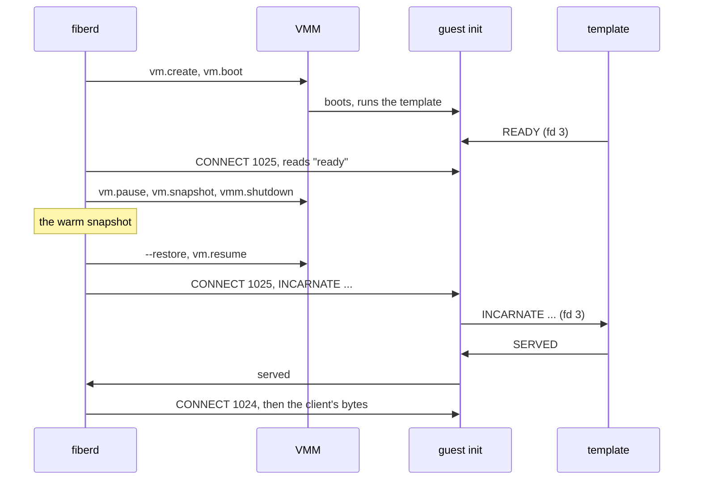

# cloudhv guest protocol

fiberd's `cloudhv` backend (`pkg/backend/cloudhv`) drives one Cloud Hypervisor VMM per fiber over its API socket and talks to the guest over the VM's hybrid vsock socket. This note is the contract between the backend, the guest init (`guest/init.c`), the reference template (`vmtemplate`) and the fake VMM (`fakevmm`), which plays the VMM and the guest init without KVM.

## The API subset

Every call is HTTP/1.1 on `--api-socket path=<socket>`, under `/api/v1/`, one request per connection. The fake VMM answers these and no others.

| Call | Method | Body | When |
| --- | --- | --- | --- |
| `vmm.ping` | GET | none | Waiting for a VMM to come up |
| `vm.create` | PUT | `VmConfig` with `cpus`, `memory.size`, `payload.kernel` and `cmdline`, one read-only raw `disks` entry, `vsock` (`cid` 3, `socket`), `rng`, `serial` (`File`) and `console` (`Off`) | Warm |
| `vm.boot` | PUT | none | Warm |
| `vm.info` | GET | none, answers `state` | A restore is done once it says `Paused` |
| `vm.pause` | PUT | none | Before every snapshot |
| `vm.snapshot` | PUT | `{"destination_url": "file://<dir>"}` | Warm and park |
| `vm.resume` | PUT | none | After a restore, a Sync park, and a failed park |
| `vmm.shutdown` | PUT | none | Every end of a VMM |

A restore is the command line flag `--restore source_url=file://<dir>[,memory_restore_mode=<mode>]`. A Clone restores with `memory_restore_mode=copyonwrite` (v54.0), unless the backend is told `copy` or `ondemand`. A Resume restores in copy mode, which needs no option. The fake takes the same three modes, and it refuses `prefault` with any mode but `copy`, as v54.0 does. The VM comes up paused. Every path the backend names is a path inside the VMM's mount namespace (`/fiberd/vm/...`), the same in every VMM, so a snapshot restores in any fiber's namespace.

The fake's snapshot is `config.json` (the body of `vm.create`), `state.json` (the guest init's state) and an empty `memory-ranges`. Its restore starts the template afresh and puts the guest init in the recorded state, so the template's memory does not survive a park there.

## vsock

The host reaches a guest port by connecting to the vsock socket and writing `CONNECT <port>`, one line. The VMM answers `OK <host port>` once the guest has accepted, and drops the connection when nothing listens. A guest reaches host port N through the host's unix socket `<vsock socket>_N`. The fake VMM serves the same handshake, and its template reaches `<vsock socket>_N` directly through `FIBERD_FAKE_VSOCK`.

| Port | Side | What |
| --- | --- | --- |
| 1024 | guest | The fiber's endpoint, spliced to the template's unix socket while an incarnation serves |
| 1025 | guest | The control port, one command per connection |
| 5000 | host | The grant's engine, `FIBERD_ENGINE=vsock://2:5000` in the template (linked in M10b) |

## The control port

The guest init listens only once the template has said READY. On every connection it writes its state first, `ready`, `serving` or `parked`. fiberd then writes one line and reads one answer.

| Line | Allowed in | Answer |
| --- | --- | --- |
| `INCARNATE <generation> <fence> <seed-hex> <payload-hex or -> <session-hex or ->` | `ready`, `parked` | `served` once the template serves |
| `PARK` | `serving` | `parked` once the template has closed its endpoint and every spliced connection is gone |
| `UNPARK` | `parked` | `served`, after a park that failed past the guest |

Anything else, or a line in the wrong state, is answered `error <why>`. The seed is 32 bytes. The guest init adds it to the kernel's pool with `RNDADDENTROPY`, forces a reseed with `RNDRESEEDCRNG`, and passes the line on, so the template reseeds its own generators from it too. Neither logs it.

## The template's channel

The template runs with a stream socket on fd 3 and `FIBERD_ENDPOINT`, the unix socket it serves on. It writes `READY` once warm, then answers the guest init's lines.

| From the guest init | The template |
| --- | --- |
| `INCARNATE ...` as above | Reseeds, binds `FIBERD_ENDPOINT`, answers `SERVED` |
| `PARK` | Closes its endpoint and connections, answers `PARKED` |
| `UNPARK` | Binds again under the same incarnation, answers `SERVED` |

Any other answer is passed to fiberd as `error template <answer>`. A template that ends powers the guest off, which ends the VMM.
