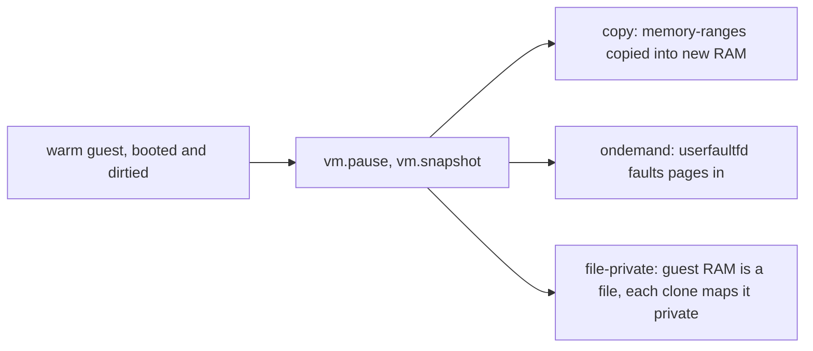

# Cloud Hypervisor spikes S1 to S5

Five short experiments that answer what the `cloudhv` backend depends on, before any backend code exists. The design is in `docs/proposals/gpu-poc.md`, Part 2. Each spike runs on a KVM host, either your own VM or a GitHub runner through `.github/workflows/cloudhv-spike.yml`.

Nothing here was run by its author. Every number comes from your run.

## What each spike answers

| Spike | Question | Script | Pass or answer |
| --- | --- | --- | --- |
| S1 | Can a restore share the warm snapshot's memory copy-on-write, and what does a Clone cost in time and private memory | `s1-cow.sh` | A table per restore mode of `vm.resume` time, served time, and each VMM's Private_Dirty, Rss and Pss with 64 clones alive |
| S2 | Does the engine's peer check name the VMM's leaf | `s2-peer.sh` | PASS when the peer of `<vsock>_5000` is in the VMM's cgroup leaf, for a booted and for a restored VMM |
| S3 | What happens to an open vsock connection across a snapshot and a restore | `s3-vsock-snapshot.sh` | A transcript of what the guest and the host end saw at each step |
| S4 | How long from VMM start on a snapshot to the guest's served line | `s4-served.sh` | min, median and max of 20 runs per restore mode |
| S5 | Which CPU facts a snapshot depends on | `s5-cpu.sh` | Both hosts' CPU facts, the flags only one has, and whether restore, resume and served worked |

S1 tries three restore modes.



- **copy** is the default restore. Each clone holds the whole guest.
- **ondemand** is `memory_restore_mode=ondemand`. Pages come in on first touch, but still into private memory.
- **file-private** boots the warm guest with its RAM in a file mapped shared. The snapshot then skips that memory, since the file holds it. Each restore gets a copy of `config.json` with the zone's `shared` set to false, so it maps the file `MAP_PRIVATE`. That is copy-on-write against the page cache, which is the cheap Clone fiberd wants.

The design also asks for a comparison with the Firecracker comparator on the same runner. That stays with `bench-compare.yml`, which already runs Firecracker.

## Files

| File | What it is |
| --- | --- |
| `env.sh` | The pins. Release, URLs, sha256 values, and the knobs below |
| `lib.sh` | Prerequisite checks, cleanup, the warm snapshot, shared helpers |
| `setup.sh` | Downloads and verifies the binary and kernel, builds the guest. Idempotent, no root |
| `guest.c` | The guest's static init. It listens on vsock port 1024 and answers one command per connection |
| `hostctl.py` | The host side. Starts VMMs, speaks HTTP to the API socket and hybrid vsock to the guest, and times each step itself |
| `s1-cow.sh` to `s5-cpu.sh` | The spikes |

## How to run

You need an x86_64 Linux host with `/dev/kvm`, cgroup v2, `python3`, `curl`, `cc` with a static libc (`libc6-dev`), `cpio` and `gzip`. The spikes need root for the cgroup leaves and `/dev/kvm`. Each script checks what it needs first and fails by name.

```sh
bash hack/cloudhv/spike/setup.sh
sudo bash hack/cloudhv/spike/s1-cow.sh
sudo bash hack/cloudhv/spike/s2-peer.sh
sudo bash hack/cloudhv/spike/s3-vsock-snapshot.sh
sudo bash hack/cloudhv/spike/s4-served.sh
# S5 needs two hosts. Copy the tarball from the first to the second.
sudo bash hack/cloudhv/spike/s5-cpu.sh snapshot s5-$(hostname).tar.gz
sudo bash hack/cloudhv/spike/s5-cpu.sh restore s5-<first host>.tar.gz
```

Everything lands in `SPIKE_DIR`, `/var/tmp/cloudhv-spike` by default. `sudo` drops most of your environment, so pass knobs through `env`, for example `sudo env SPIKE_MEM_MB=256 S1_COUNT=32 bash hack/cloudhv/spike/s1-cow.sh`.

| Knob | Default | Meaning |
| --- | --- | --- |
| `SPIKE_DIR` | `/var/tmp/cloudhv-spike` | Work directory |
| `SPIKE_MEM_MB` | 128 | Guest RAM per VM |
| `SPIKE_WARM_MB` | 32 | What the warm guest dirties before its snapshot |
| `SPIKE_DIRTY_MB` | 4 | What each S1 clone dirties after it is served |
| `S1_COUNT` | 64 | Clones alive at once in S1. Copy mode lowers it to what fits in 80% of free memory |
| `S1_MODES`, `S4_MODES` | `copy ondemand file-private` | Restore modes to try |
| `S4_RUNS` | 20 | Runs per mode in S4 |
| `S5_MEM_MB` | 64 | Guest RAM for the S5 snapshot |

## What to paste back

- **S1 and S4.** The block after the run's last blank line, from the `S1 on` or `S4 on` line to the end.
- **S2.** Everything from `boot:` to the final `S2 on` line.
- **S3.** The two sections after `S3 on`, what the guest saw and what the host end saw.
- **S5.** The whole output of the restore run, and the facts the snapshot run printed.

When a spike fails, also paste the last lines of `ch.log` and `serial.log` from the run directory it names.

## The pins

| What | Pinned to | sha256 |
| --- | --- | --- |
| Cloud Hypervisor | `v53.0`, published 2026-07-12, asset `cloud-hypervisor-static` | `448af3d4e59b22c2987f7df94c213ad40fb53a10d437e42b5ee6c4fce7c29ecc` |
| Guest kernel | `cloud-hypervisor/linux` release `ch-release-v6.16.9-20260508`, asset `vmlinux-x86_64` | `9d3570b47d5abb069ca00edfbfcef4c68306a9c3d078a01f10082b258f1001b8` |

The sha256 values are the digests GitHub records for each asset, read from the releases API on 2026-10-22. `setup.sh` refuses a file that does not match. If you move to another release, empty the pin in `env.sh`. The script then refuses to install, prints the hash it downloaded, and waits for you to pin it.

v54.0 was a week old when these were written, so the spikes pin v53.0. The kernel is the one v53.0's own integration tests download (`scripts/test-util.sh`, `download_linux`).

## What was checked against v53.0

Every API call and flag the spikes use was read in the `v53.0` tag of `cloud-hypervisor/cloud-hypervisor`, or in the kernel branch named below.

| Used here | Where it was checked | What it says |
| --- | --- | --- |
| `--api-socket path=<p>` | `cloud-hypervisor/src/main.rs`, `parse_api_socket` | Accepts `path=` or `fd=`, or a bare path |
| `vm.create`, `vm.boot`, `vm.pause`, `vm.resume`, `vm.snapshot`, `vm.restore`, `vm.info`, `vmm.ping`, `vmm.shutdown` | `docs/api.md`, REST table | All present. `vm.snapshot` needs a paused VM. The table lists "created but not booted" for `vm.restore`, while `docs/snapshot_restore.md` restores into a fresh VMM. The spikes restore with the `--restore` flag, which avoids the question |
| `vm.create` body fields `cpus`, `memory`, `payload.kernel`, `payload.initramfs`, `payload.cmdline`, `vsock`, `serial`, `console`, `rng` | `vmm/src/api/openapi/cloud-hypervisor.yaml`, `VmConfig` and its parts | Present with these names. `ConsoleMode` is one of `Off`, `Pty`, `Tty`, `File`, `Socket`, `Null`. `vm.info`'s `state` is one of `Created`, `Running`, `Shutdown`, `Paused` |
| `vm.snapshot` body `{"destination_url": "file://<dir>"}` | the same file, `VmSnapshotConfig`, and `docs/snapshot_restore.md` | The directory must exist. It gets `config.json`, `state.json` and `memory-ranges` |
| `--restore source_url=file://<dir>,memory_restore_mode=copy\|ondemand` | `vmm/src/config.rs`, `RestoreConfig::SYNTAX`, and `docs/snapshot_restore.md` | The VM comes back paused unless `resume=true`. `copy` is the default. `ondemand` uses userfaultfd and fails rather than fall back. It refuses `prefault=on` |
| Editing `config.json` between snapshot and restore | `docs/snapshot_restore.md` | Described as allowed for special cases |
| Memory zones, `file=`, `shared=` | `docs/memory.md`, `--memory-zone` | `--memory size=0` plus zones. `shared=off` maps the file `MAP_PRIVATE` |
| A shared, file-backed zone is left out of the snapshot | `vmm/src/memory_manager.rs`, `memory_range_table` | A region that is file-backed, `MAP_SHARED`, and whose file still has a link is skipped, since the file holds its bytes. A restore with `shared=false` opens the file read-only (`open_backing_file`) |
| `--vsock cid=<n>,socket=<p>`, CID at least 3 | `vmm/src/config.rs`, `VsockConfig::SYNTAX`, and the OpenAPI `VsockConfig` | As used |
| Hybrid vsock. The host writes `CONNECT <port>` and reads `OK <port>`. A guest connect to port N becomes a connect to `<socket>_N` | `docs/vsock.md`, `virtio-devices/src/vsock/unix/muxer.rs` (`handle_peer_request_pkt`, the `OK {}` reply) | The VMM process itself makes the connect to `<socket>_N`, so the peer of that socket is the VMM |
| `--serial file=<p>`, `--console off`, `--log-file`, `-v`, `--seccomp` (default `true`), `--landlock` | `cloud-hypervisor/src/main.rs` and `ConsoleConfig` parsing in `vmm/src/config.rs` | Present. Seccomp is on by default. Landlock is off unless asked |
| Guest kernel has virtio-vsock, virtio-blk, initramfs | `arch/x86/configs/ch_defconfig` on branch `ch-6.16.9` of `cloud-hypervisor/linux` | `CONFIG_VIRTIO_VSOCKETS=y`, `CONFIG_VIRTIO_BLK=y`, `CONFIG_BLK_DEV_INITRD=y`, `CONFIG_RD_GZIP=y`, `CONFIG_DEVTMPFS=y`, `CONFIG_SERIAL_8250_CONSOLE=y`. The branch head was read, not the exact commit of the release |

## Not checked

- Whether the `file-private` restore works at all. It rests on the two source facts above, and S1 will say.
- Whether `ondemand` restore of a guest with a vsock device works. S1 and S4 will say.
- `docs/vsock.md` lists `CONFIG_VHOST_VSOCK` as a host requirement. The muxer above is in user space, so the spikes do not check for it. If vsock fails on a host without it, that is the first suspect.
- How `-v` log volume affects the times. S4 runs with it on, so failures leave a useful `ch.log`.
